**Unterlagen.** Code in `fd.py`, Rechnungen und Abbildungen im Notebook `exercise_5_fd.ipynb` (jede Abbildung wird dort als PNG gespeichert). Für Teil 2 werden die Zeitschritte aus Exercise 3 (`2026-10-28/ode.py`) unverändert importiert. 36 Tests in `test_fd.py`, Herleitungen in `THEORIE.md`.

**Aufgabe.** Wärmeleitung auf $x \in [0, 1]$ mit $u(0) = u(1) = 0$, äquidistantes Gitter mit $N$ inneren Punkten $x_j = j\,\Delta x$, $\Delta x = 1/(N+1)$.

# 1 Stationäre Wärmeleitung $-u'' = f$

Testproblem $f = \pi^2\sin\pi x$, exakte Lösung $u = \sin\pi x$.

## 1a) 3-Punkte-Stern und Matrix $A$

$$-u''(x_j) \approx \frac{-u_{j-1} + 2u_j - u_{j+1}}{\Delta x^2}, \qquad A = \frac{1}{\Delta x^2}\,\mathrm{tridiag}(-1,\ 2,\ -1)$$

$A$ wird mit `scipy.sparse.diags` gebaut und hat nur $3N - 2$ von $N^2$ Einträgen. In der ersten und letzten Zeile fällt ein Nachbar weg, weil $u_0 = u_{N+1} = 0$ bekannt sind.

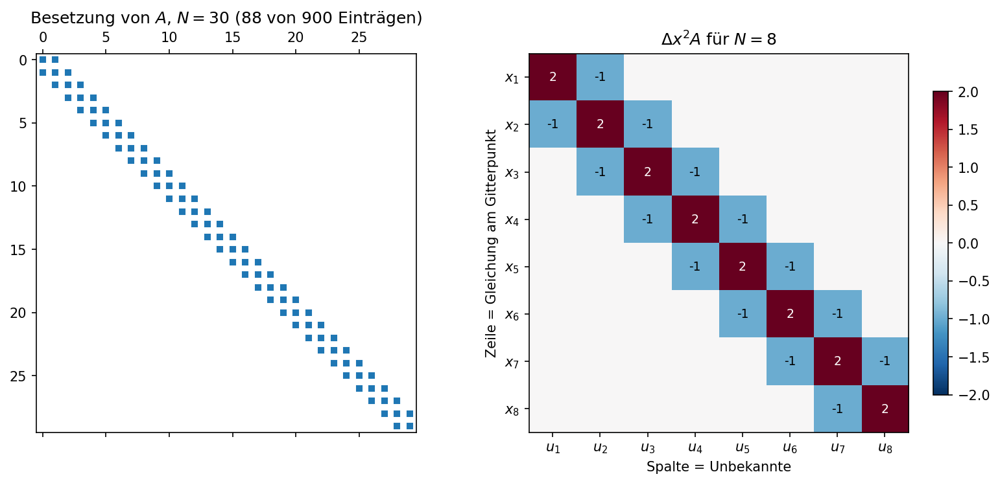{width=88%}

**Wie kann man $A$ prüfen, bevor man etwas löst?**
Mit Eigenschaften, die man vorher kennt (gemessen für $N = 20$):

- $A$ ist symmetrisch: $\max|A - A^T| = 0$.
- Die inneren Zeilensummen sind 0, denn die zweite Ableitung einer Konstanten verschwindet.
- Für $u = x(1-x)$ ist $Au = 2$ exakt (Abweichung $4\cdot10^{-14}$), weil der Abbruchfehler $\frac{\Delta x^2}{12}u''''$ für ein Polynom vom Grad 2 null ist.
- Die Eigenwerte stimmen mit $\lambda_k = \frac{4}{\Delta x^2}\sin^2\frac{k\pi\Delta x}{2}$ überein (relativ $2\cdot10^{-14}$) und sind alle positiv: $\lambda_1 = 9{,}851$, $\pi^2 = 9{,}870$.

Alle diese Prüfungen stehen auch als Tests in `test_fd.py`.

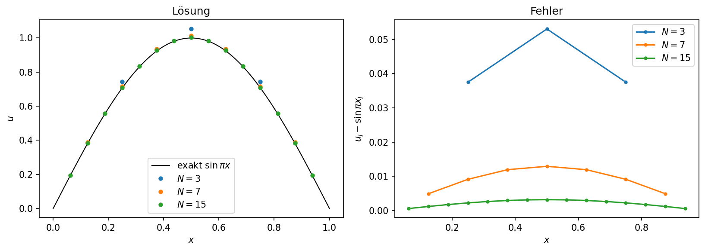{width=88%}

## 1b) Fehler über $\Delta x$

Gitter $N = 2^k - 1$ für $k = 2 \dots 20$, also $N = 3$ bis $N \approx 10^6$. Damit sind $\Delta x$ und alle $x_j$ exakt als `float64` darstellbar.

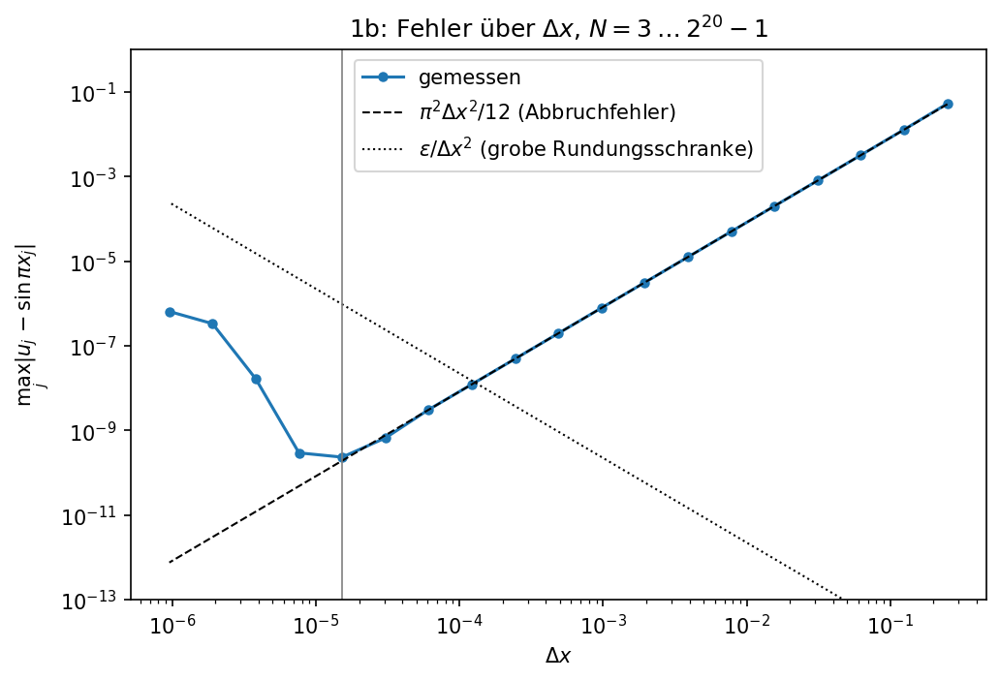{width=62%}

**Welche Steigung erwartet man, welche bekommt man?**
Erwartet ist Steigung 2, denn der 3-Punkte-Stern hat den Abbruchfehler $\frac{\Delta x^2}{12}u''''$. Gemessen ist **Steigung 2,00** bis $N = 8191$: Der Fehler viertelt sich pro Halbierung von $\Delta x$ und liegt fast genau auf $\pi^2\Delta x^2/12$.

**Unter welchem $\Delta x$ wächst der Fehler wieder, und warum?**
Das Minimum ist $2{,}3\cdot10^{-10}$ bei **$\Delta x \approx 1{,}5\cdot10^{-5}$** ($N = 65\,535$). Darunter wächst der Fehler steil und unregelmäßig, bis $6{,}5\cdot10^{-7}$ bei $N \approx 10^6$. Ursache sind Rundungsfehler: Die Einträge von $A$ sind von der Größe $1/\Delta x^2$, im Stern ziehen sich fast gleich große Zahlen voneinander ab, und die Konditionszahl $\kappa(A) \approx 4/(\pi^2\Delta x^2)$ wächst. Die Schranke $\varepsilon/\Delta x^2$ gilt für den schlimmsten Fall; der echte Rundungsfehler liegt darunter. Ab dem Minimum bringt ein feineres Gitter nichts mehr.

## 1c) Stencils höherer Ordnung

Zentrale Sterne für $-u''$ (Gewichte mal $1/\Delta x^2$):

$$\begin{aligned}
\text{Ordnung 2:}&\quad (-1,\ 2,\ -1)\\
\text{Ordnung 4:}&\quad \tfrac{1}{12}\,(1,\ -16,\ 30,\ -16,\ 1)\\
\text{Ordnung 6:}&\quad \tfrac{1}{180}\,(-2,\ 27,\ -270,\ 490,\ -270,\ 27,\ -2)
\end{aligned}$$

**Was macht man am Rand?**
Der breite Stern reicht über $x_0 = 0$ hinaus. Ich habe zwei Varianten verglichen:

- **reduce:** In den randnahen Zeilen den größten zentralen Stern nehmen, der noch passt. Das ist einfach, kostet aber Genauigkeit.
- **mirror:** Geisterpunkte durch ungerade Spiegelung $u_{-m} = -u_m$. Das ist richtig, wenn alle geraden Ableitungen am Rand verschwinden, wie bei $\sin\pi x$.

Allgemein nimmt man einseitige Sterne gleicher Ordnung; dann wird $A$ unsymmetrisch.

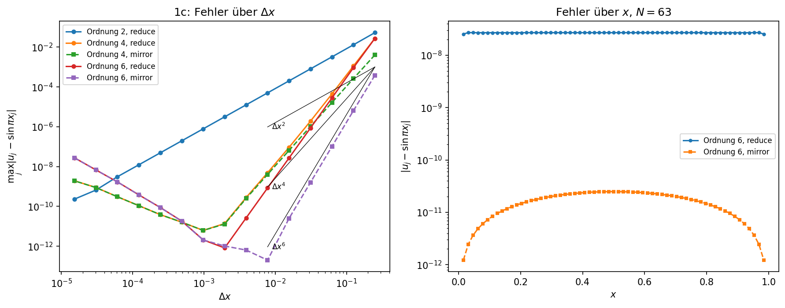{width=100%}

**Welche Ordnungen bekommt man?**
Raten $\log_2$ des Fehlerverhältnisses für $N = 7 \dots 255$:

| Stern      | mirror | reduce          |
|:-----------|:------:|:---------------:|
| Ordnung 2  | 2,00   | 2,00            |
| Ordnung 4  | 4,00   | 4,7 → 4,1       |
| Ordnung 6  | 6,00   | **5,00**        |

Mit Spiegelung bekommt man genau die Ordnung des Sterns. Mit reduce verliert Ordnung 6 eine Ordnung: Die verkleinerte Randzeile hat den Abbruchfehler $\tau_1 \approx \frac{\pi^5}{12}\Delta x^3$ und verschiebt damit die ganze Lösung um etwa $\Delta x^2\tau_1 \sim \Delta x^5$. Bei Ordnung 4 ist das kleiner als der innere Fehler, bei Ordnung 6 größer. Im rechten Bild sieht man, dass der Fehler mit reduce auch in der Intervallmitte größer ist.

Je höher die Ordnung, desto früher erreicht man den Rundungsboden: Ordnung 6 mit Spiegelung kommt schon bei $N = 127$ auf $2\cdot10^{-13}$.

## 1d) Neumann-Rand $u'(1) = 0$

Testproblem $f = \frac{\pi^2}{4}\sin\frac{\pi x}{2}$, exakte Lösung $u = \sin\frac{\pi x}{2}$. Der Randwert $u_{N+1}$ ist jetzt unbekannt und bekommt eine eigene Zeile:

- **first:** einseitige Differenz $\frac{u_{N+1} - u_N}{\Delta x} = 0$.
- **ghost:** Geisterpunkt $u_{N+2} = u_N$ aus der zentralen Differenz, eingesetzt in den Stern: $\frac{-2u_N + 2u_{N+1}}{\Delta x^2} = f(1)$. Die Zeile wird halbiert, damit $A$ symmetrisch bleibt.

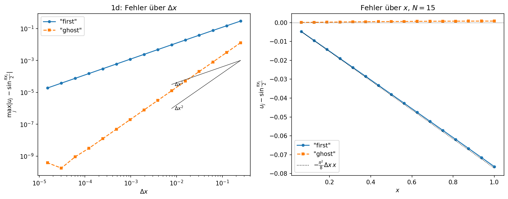{width=100%}

**Welche Steigung bekommt man?**
Mit der einseitigen Differenz **Steigung 1** (Raten 0,97 → 1,00), mit dem Geisterpunkt **Steigung 2** (Raten 2,00). Die inneren Zeilen sind in beiden Fällen gleich; die eine Randzeile entscheidet über die Ordnung der ganzen Lösung.

**Wie wirkt sich die Diskretisierung des Randes auf die ganze Lösung aus?**
Der Fehler bleibt nicht am Rand. Taylor gibt $\frac{u_{N+1} - u_N}{\Delta x} = u'(1) - \frac{\Delta x}{2}u''(1)$, die Zeile erzwingt also in Wahrheit $u'(1) = -\frac{\pi^2}{8}\Delta x$. Der Fehler ist die Lösung von $-e'' = 0$ mit $e(0) = 0$ und dieser Steigung: eine Gerade $-\frac{\pi^2}{8}\Delta x\,x$ durch das ganze Intervall (rechtes Bild). Eine elliptische Gleichung verteilt jeden Randfehler über das ganze Gebiet.

## 1e) 2D-Poisson

$-\Delta u = 2\pi^2\sin\pi x\,\sin\pi y$ auf dem Einheitsquadrat, $u = 0$ am Rand, exakt $u = \sin\pi x\,\sin\pi y$. Mit $N \times N$ inneren Punkten gibt es $N^2$ Unbekannte. Die Matrix entsteht aus der 1D-Matrix:

$$A_{2D} = A \otimes I + I \otimes A \quad\text{(5-Punkte-Stern, mit } \texttt{scipy.sparse.kron}\text{)}$$

{width=100%}

**Wie skalieren Fehler und Laufzeit mit $N$?**

- **Fehler:** Steigung **2,00** über $\Delta x$, also $\propto N^{-2}$ wie in 1D. Er liegt genau auf $\pi^2\Delta x^2/12$, weil die rechte Seite ein Eigenvektor von $A_{2D}$ ist. Bis $N = 1023$ gibt es keinen Wiederanstieg; das Rundungsminimum aus 1b läge bei $4\cdot10^9$ Unbekannten.
- **Laufzeit:** Steigung **2,8** über $N$, also fast $N^3 = n^{1{,}5}$ für $n = N^2$ Unbekannte ($N = 511$: 1,3\ s, $N = 1023$: 10\ s). Halbes $\Delta x$ kostet etwa achtmal so viel Zeit und viertelt nur den Fehler. Grund: Die Matrix hat die Bandbreite $N$, und beim Faktorisieren füllt sich das Band auf. Für größere Gitter nimmt man iterative Löser (CG, Mehrgitter) oder die FFT.

# 2 Zeitabhängige Wärmeleitung $u_t = u_{xx}$

Start $u(x, 0) = \sin\pi x$, exakte Lösung $u = e^{-\pi^2 t}\sin\pi x$.

## 2a) Linienmethode

Nur der Raum wird diskretisiert. Mit $A$ aus Teil 1 entsteht das lineare System $\dot u = -Au$, also $\dot x = Jx$ aus Exercise 3 mit $J = -A$. Crank–Nicolson ist ein halber expliziter und ein halber impliziter Schritt:

$$\left(I - \tfrac{\Delta t}{2}J\right)u^{n+1} = \left(I + \tfrac{\Delta t}{2}J\right)u^n$$

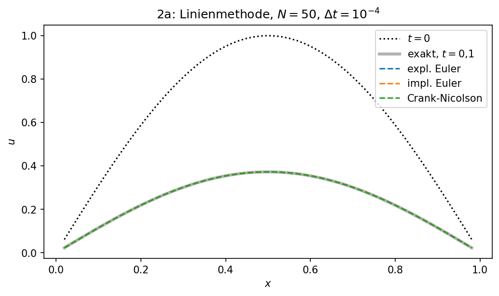{width=62%}

**Welche Teile des Codes aus Exercise 3 kann man unverändert verwenden?**
`euler_step`, `heun_step` und `rk4_step` brauchen nur `J @ x` und laufen mit der sparse-Matrix unverändert. Ebenso `integrate`, `order`, `stability_function` und `critical_dt` (mit $\lambda_1, \lambda_N$ statt $k_1, k_2$). Nur `implicit_euler_step` passt nicht, weil es `np.eye` und `np.linalg.solve` (dense) benutzt; `fd.py` hat eine Version mit `spsolve`.
Fehler gegen die PDE-Lösung bei $t = 0{,}1$, $\Delta t = 10^{-4}$: expliziter Euler $6{,}5\cdot10^{-5}$, impliziter Euler $3{,}0\cdot10^{-4}$, Crank–Nicolson $1{,}2\cdot10^{-4}$.

## 2b) Genauigkeit

Zwei Referenzen bei $t = 0{,}1$: die PDE-Lösung $e^{-\pi^2 t}\sin\pi x_j$ und die exakte ODE-Lösung $e^{-\lambda_1 t}\sin\pi x_j$ mit $\lambda_1 = 9{,}8665$. Ihr Abstand $1{,}16\cdot10^{-4}$ ist der reine Raumfehler bei $N = 50$.

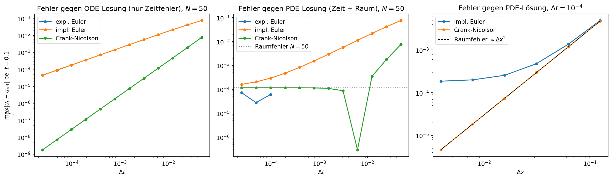{width=100%}

**Welche Steigungen erwartet man?**
In $\Delta t$: expliziter und impliziter Euler 1, Crank–Nicolson 2. Gemessen gegen die ODE-Lösung: **1,00 / 1,00 / 2,00**. In $\Delta x$: 2 wegen des 3-Punkte-Sterns. Crank–Nicolson mit $\Delta t = 10^{-4}$ liegt genau auf $\Delta x^2$ (bis $4{,}6\cdot10^{-6}$).

**Warum hört der Fehler irgendwann auf zu fallen?**
Gegen die PDE-Lösung bleibt immer der Fehler der anderen Diskretisierung übrig. In der $\Delta t$-Studie ist das der Raumfehler $1{,}16\cdot10^{-4}$ (graue Linie). In der $\Delta x$-Studie bleibt der implizite Euler bei $1{,}9\cdot10^{-4}$ stehen, das ist sein Zeitfehler bei $\Delta t = 10^{-4}$. Crank–Nicolson hat dort nur etwa $10^{-9}$ Zeitfehler und fällt weiter.

Im mittleren Bild liegen expliziter Euler und Crank–Nicolson teils *unter* dem Raumfehler, Crank–Nicolson mit einem Knick bei $\Delta t \approx 6\cdot10^{-3}$. Das ist Fehlerauslöschung: Wegen $\lambda_1 < \pi^2$ klingt die ODE-Lösung etwas zu langsam ab, die beiden Verfahren dämpfen pro Schritt etwas zu stark. Der explizite Euler ist nur für $\Delta t < 2/\lambda_N = 1{,}92\cdot10^{-4}$ eingezeichnet.

## 2c) Stabilität

Eigenvektoren $\sin(k\pi x_j)$, Eigenwerte $\lambda_k = \frac{4}{\Delta x^2}\sin^2\frac{k\pi\Delta x}{2}$. Mode $k$ wird pro Schritt mit $R(z_k)$ multipliziert, $z_k = -\lambda_k\Delta t$.

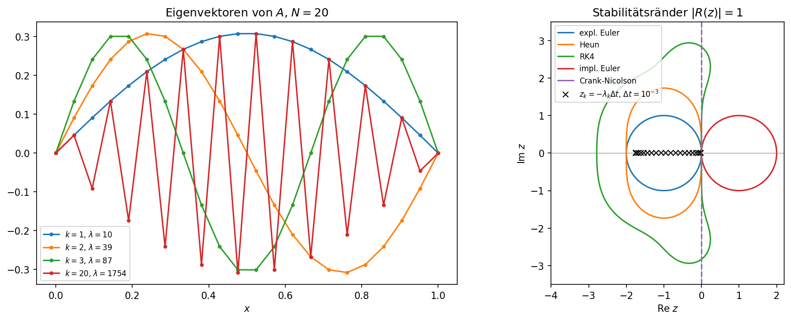{width=100%}

Kritisches $\Delta t$ im Vergleich mit der von-Neumann-Schranke $\Delta x^2/2$:

| $N$ | $\lambda_N$ | Euler, Heun | RK4 | von Neumann |
|----:|------------:|------------:|----:|------------:|
| 10  | 474,2    | $4{,}218\cdot10^{-3}$ | $5{,}874\cdot10^{-3}$ | $4{,}132\cdot10^{-3}$ |
| 20  | 1754,1   | $1{,}140\cdot10^{-3}$ | $1{,}588\cdot10^{-3}$ | $1{,}134\cdot10^{-3}$ |
| 40  | 6714,1   | $2{,}979\cdot10^{-4}$ | $4{,}148\cdot10^{-4}$ | $2{,}974\cdot10^{-4}$ |
| 80  | 26234,1  | $7{,}624\cdot10^{-5}$ | $1{,}062\cdot10^{-4}$ | $7{,}621\cdot10^{-5}$ |

**Welcher Eigenwert entscheidet über die Stabilität?**
Der größte, $\lambda_N \approx 4/\Delta x^2$. Alle $z_k$ liegen auf der negativen reellen Achse, $z_N$ am weitesten links. Also ist $\Delta t_{\text{krit}} = 2/\lambda_N$ für Euler und Heun und $2{,}785/\lambda_N$ für RK4. Von Neumann setzt $\sin^2 = 1$ und liegt deshalb immer knapp darunter, mit feinerem Gitter immer näher. Halbes $\Delta x$ heißt ein Viertel $\Delta t$.

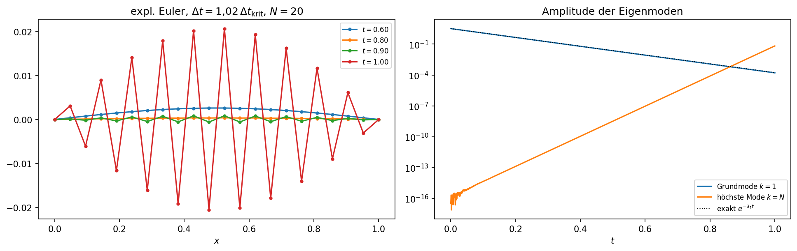{width=100%}

**Wie sieht die Lösung knapp über dem kritischen Zeitschritt aus?**
Die höchste Mode wird pro Schritt mit $|R| = 1{,}04$ multipliziert und wechselt jedes Mal das Vorzeichen. Sie wächst exponentiell von Rundungsniveau an, während die Grundmode richtig abklingt, und überholt diese bei $t \approx 0{,}87$. Danach sieht man nur noch einen Zickzack von Punkt zu Punkt mit sinusförmiger Einhüllender, also den Eigenvektor $k = N$.

**Warum sind impliziter Euler und Crank–Nicolson für jedes $\Delta t$ stabil?**
Für $z < 0$ gilt $\left|\frac{1}{1-z}\right| < 1$ und $\left|\frac{1+z/2}{1-z/2}\right| < 1$, egal wie groß $|z|$ ist. Beide Stabilitätsgebiete enthalten die ganze linke Halbebene (A-stabil): Beim impliziten Euler ist alles außerhalb des roten Kreises stabil, bei Crank–Nicolson genau die linke Halbebene.

## 2d) Steifheit und unglatte Startwerte

Rechteckpuls $u(x, 0) = 1$ für $0{,}25 < x < 0{,}75$, sonst 0, mit $N = 99$. Referenzen: die Sinusreihe der PDE-Lösung und die Eigenzerlegung von $A$ für die ODE-Lösung. Die Eigenwerte reichen von 9,87 bis 39 990 (Verhältnis 4052): Das System ist steif.

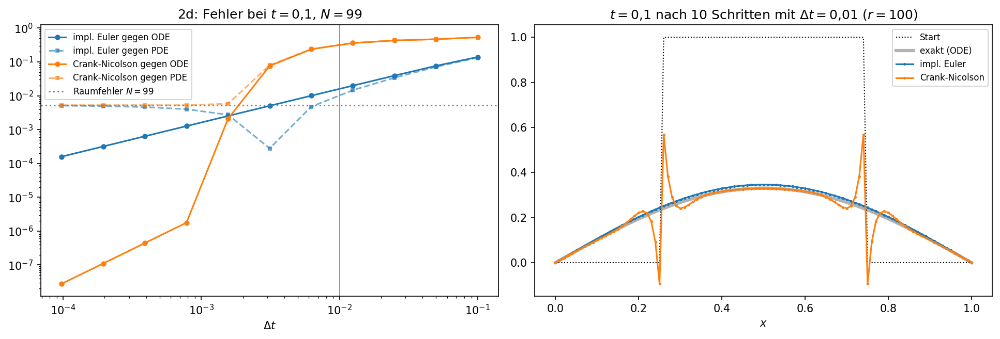{width=100%}

**Wiederholung von 2b: Steigungen und Grenzen.**
In $\Delta t$ gegen die ODE-Lösung wie in 2b: impliziter Euler 1, Crank–Nicolson 2, Letzteres aber erst unter $\Delta t \approx 1{,}6\cdot10^{-3}$. Gegen die PDE-Lösung bleiben beide bei $5{,}3\cdot10^{-3}$ stehen, dem Raumfehler von $N = 99$. Der ist so groß, weil der Sprung dort punktweise abgetastet wird und nur Ordnung 1 hat (Tabelle unten).
Für die Raumstudie liegen die Sprünge auf Gitterpunkten ($N = 20\cdot2^m - 1$). Dann hängt die Ordnung davon ab, wie man den Sprung abtastet:

| $N$ | Sprung $= 0$ | Sprung $= \frac12$ | CN, $\Delta t = 10^{-4}$ | IE, $\Delta t = 10^{-4}$ |
|----:|----------:|----------:|----------:|----------:|
| 19  | $2{,}6\cdot10^{-2}$ | $1{,}2\cdot10^{-5}$ | $1{,}2\cdot10^{-5}$ | $1{,}6\cdot10^{-4}$ |
| 79  | $6{,}6\cdot10^{-3}$ | $7{,}0\cdot10^{-7}$ | $7{,}1\cdot10^{-7}$ | $1{,}7\cdot10^{-4}$ |
| 319 | $1{,}6\cdot10^{-3}$ | $4{,}3\cdot10^{-8}$ | $5{,}9\cdot10^{-8}$ | $1{,}7\cdot10^{-4}$ |
| 639 | $8{,}2\cdot10^{-4}$ | $1{,}1\cdot10^{-8}$ | $3{,}2\cdot10^{-8}$ | $1{,}7\cdot10^{-4}$ |
| Steigung | **1,00** | **2,00** | 2 → 0,9 | 0 |

Die ersten beiden Spalten sind ohne Zeitfehler (exakte ODE-Lösung). Punktweise abgetastet ($u_0 = 0$ genau am Sprung) gibt es nur **Ordnung 1**: Der diskrete Puls ist pro Seite eine halbe Zelle zu schmal, die Wärmemenge stimmt um $O(\Delta x)$ nicht, und dieser Fehler klingt nicht ab. Mit dem Mittelwert $\frac12$ am Sprung stimmt die Wärmemenge, und es kommt wieder **Ordnung 2** heraus. Mit $\Delta t = 10^{-4}$ bleibt der implizite Euler bei seinem Zeitfehler ($1{,}7\cdot10^{-4}$) stehen. Crank–Nicolson flacht aus demselben Grund bei $N = 639$ ab: Sein Zeitfehler ist dort $2{,}9\cdot10^{-8}$, unabhängig von $N$, und damit größer als der Raumfehler $1{,}1\cdot10^{-8}$.

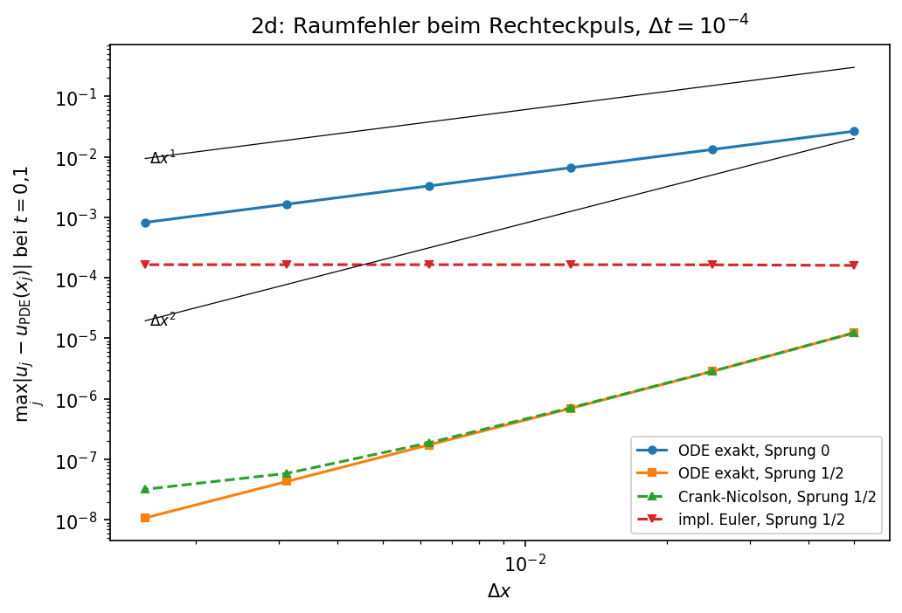{width=62%}

![Dämpfung $|R(z)|$ pro Schritt für $z \in [-1000, 0]$ (links) und Amplitude der höchsten Mode über der Zeit, $\Delta t = 0{,}01$ (rechts).](damping_2d.png){width=100%}

**Warum ist Crank–Nicolson, in 2b das beste Verfahren, jetzt schlechter als der implizite Euler?**
Der Sprung enthält alle Moden. Bei $\Delta t = 0{,}01$ ist $z_N = -400$ und $R_{\text{CN}}(z_N) = -0{,}990$: Die schnellen Moden werden kaum gedämpft und wechseln jeden Schritt das Vorzeichen, exakt wäre $e^{-400} \approx 0$. Der implizite Euler hat $R_{\text{IE}}(z_N) = 0{,}0025$; er ist L-stabil, $R(z) \to 0$ für $z \to -\infty$, bei Crank–Nicolson dagegen $R \to -1$. Fehler gegen die ODE-Lösung bei $t = 0{,}1$: **0,016 (impliziter Euler) gegen 0,33 (Crank–Nicolson)**, mit Überschwingern direkt an den Sprungstellen.

**Verschwinden die schnellen Moden überhaupt?**
Bei Crank–Nicolson nur langsam: Die höchste Mode fällt in 100 Schritten von 0,10 auf 0,037 ($0{,}99^{100} \approx 0{,}37$) und ist ab $t \approx 0{,}47$ größer als die Grundmode. Beim impliziten Euler ist sie nach 5 Schritten auf Rundungsniveau.

**Wie viele Schritte bräuchte der explizite Euler, und wie ändert sich das bei feinerem Gitter?**
$\Delta t_{\text{krit}} = 2/\lambda_N = 5\cdot10^{-5}$, also mindestens **2000 Schritte** bis $t = 0{,}1$ statt 10. Halbes $\Delta x$ heißt viermal so viele Schritte (8000 bei $N = 199$, 32 000 bei $N = 399$), und jeder Schritt kostet doppelt so viel: Der Gesamtaufwand wächst wie $N^3$. Deshalb rechnet man Diffusion implizit.
