**Unterlagen.** Code in `schroedinger.py`, alle Simulationen und Abbildungen in `figures.py` (`python figures.py 2c` rechnet nur Teil 2c), alle Zahlen dieses Texts in `results.json`. 28 Tests in `test_schroedinger.py`, ausführliche Herleitungen in `theory.md`. Die Animationen `double_slit_3a.gif` und `mach_zehnder_3b.gif` gehören zu 3a und 3b.

**Methode.** Einheiten $\hbar = m = 1$. Auf dem Gitter $x_j = a + j\,\Delta x$ mit $\psi = 0$ an den Enden wird der Hamilton-Operator zur dünnen Matrix
$$H = -\frac{1}{2\Delta x^2}\,\mathrm{tridiag}(1,\,-2,\,1) + \mathrm{diag}(V).$$
Eine ebene Welle $e^{ikx}$ hat auf dem Gitter die Energie $E_{\rm FD}(k) = \frac{1-\cos k\Delta x}{\Delta x^2} = \frac{k^2}{2}\bigl(1 - \frac{(k\Delta x)^2}{12} + \dots\bigr)$. Fast alle Genauigkeitsfragen unten folgen aus dieser Formel.

# 1 Stationäre Schrödinger-Gleichung $H\psi = E\psi$

Eigenwerte mit `scipy.linalg.eigh_tridiagonal`.

## 1a) Harmonischer Oszillator, exakt $E_n = n + \frac{1}{2}$

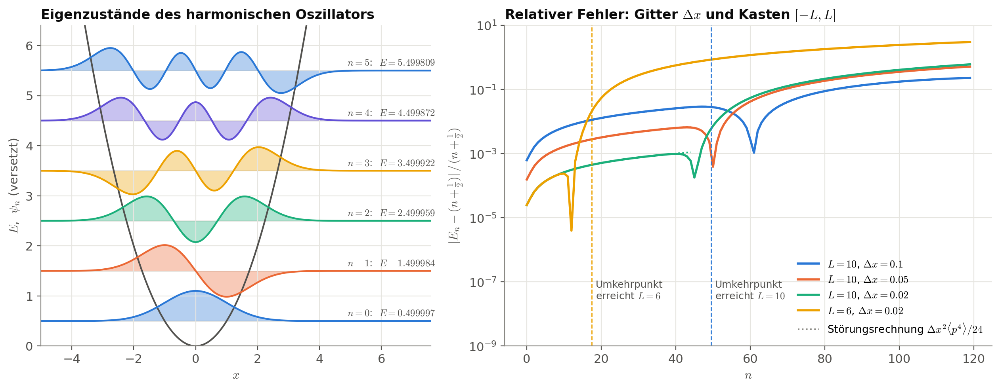{width=100%}

**Welche Niveaus sind genau?**
Die tiefen. Bei $\Delta x = 0{,}02$ und $L = 10$ ist $E_0 = 0{,}4999875$, und die Niveaus $n = 0 \dots 46$ (**47 Niveaus**) haben einen relativen Fehler unter $10^{-3}$.

**Was begrenzt die Genauigkeit?**
Zwei Dinge, im rechten Bild getrennt zu sehen:

- **Das Gitter.** Höhere Zustände haben eine größere lokale Wellenzahl, und $E_{\rm FD}$ liegt unter $k^2/2$. Störungsrechnung gibt $\Delta E_n \approx -\frac{\Delta x^2}{32}(2n^2 + 2n + 1)$; für $n = 0$ genau die gemessenen $1{,}25\cdot10^{-5}$. Halbes $\Delta x$ gibt ein Viertel des Fehlers.
- **Der Kasten.** Erreicht der klassische Umkehrpunkt $\sqrt{2n+1}$ die Wand $L$, also bei $n \approx (L^2-1)/2$, wird der Zustand gequetscht und $E$ steigt steil an. Bei $L = 6$ sind deshalb trotz feinem Gitter nur 14 Niveaus gut.

Am Knick im Fehler wechselt das Vorzeichen: Das Gitter macht $E$ zu klein, die Wand zu groß.

## 1b) Unendlicher Topf auf $[0, 1]$, exakt $E_n = n^2\pi^2/2$

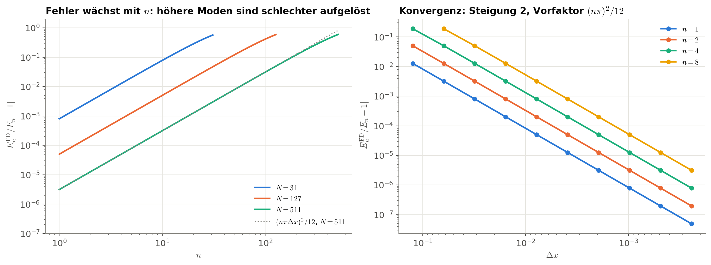{width=100%}

**Wie hängt der Fehler von $n$ und $\Delta x$ ab?**
Die Eigenvektoren sind die abgetasteten Sinus, das Gitterspektrum ist exakt bekannt:
$$E_n^{\rm FD} = \frac{2}{\Delta x^2}\sin^2\frac{n\pi\Delta x}{2} \quad\Rightarrow\quad \frac{E_n^{\rm FD}}{E_n} - 1 \approx -\frac{(n\pi\Delta x)^2}{12}.$$

- In $\Delta x$ quadratisch: gemessene Steigung **2,000** für $n = 1, 2, 4, 8$.
- In $n$ ebenfalls quadratisch, denn $n\pi\Delta x$ ist der Phasenschritt pro Gitterpunkt. Für $n \to N$ sättigt das Spektrum bei $2/\Delta x^2$, der Fehler wird von der Ordnung 1.

Der relative Fehler hängt also nur davon ab, wie viele Gitterpunkte auf eine Wellenlänge kommen.

## 1c) Endlicher Topf $V_0 = 10$, $a = 1$

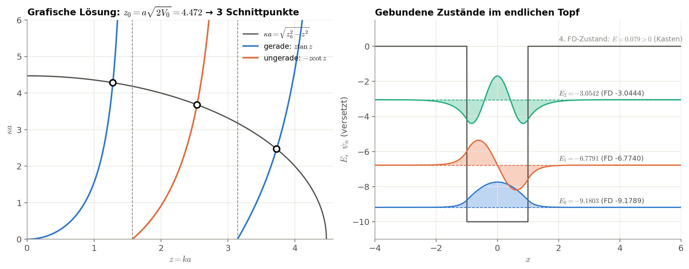{width=100%}

Mit $z = ka$ wird $(\kappa a)^2 = z_0^2 - z^2$ ein Viertelkreis; jede Schnittstelle mit einem Ast von $z\tan z$ bzw. $-z\cot z$ ist ein gebundener Zustand. Gelöst mit `brentq` in der polfreien Form $z\sin z = \sqrt{z_0^2 - z^2}\cos z$ (gerade) und $z\cos z = -\sqrt{z_0^2 - z^2}\sin z$ (ungerade).

**Wie viele gebundene Zustände gibt es?**
Alle $\pi/2$ beginnt ein neuer Ast: $N = \lceil z_0/(\pi/2) \rceil = \lceil 2{,}847 \rceil = \mathbf{3}$.

| Zustand | analytisch | FD, $\Delta x = 0{,}002$ |
|:--|--:|--:|
| $E_0$ (gerade) | $-9{,}1803$ | $-9{,}1789$ |
| $E_1$ (ungerade) | $-6{,}7791$ | $-6{,}7740$ |
| $E_2$ (gerade) | $-3{,}0542$ | $-3{,}0444$ |

Die Abweichung ist größer als beim Oszillator, weil $V$ bei $x = \pm a$ springt und der Sprung nur auf $\pm\Delta x$ genau auf dem Gitter liegt. Der vierte FD-Zustand hat $E = +0{,}079$ und ist ein Kastenzustand des Rechengebiets $[-8, 8]$, kein gebundener Zustand.

# 2 Zeitabhängige Schrödinger-Gleichung $i\,\partial_t\psi = H\psi$

## 2a) Freies Paket, $\sigma = 1$, $k_0 = 2$

Gitter $[-20, 40]$, $\Delta x = 0{,}05$, $\Delta t = 0{,}01$ bis $t = 10$. Für einen Eigenvektor von $H$ zum Eigenwert $\lambda$ multipliziert ein Schritt mit:

| Verfahren | Verstärkung $g(\lambda)$ | $\lvert g \rvert$ |
|:--|:--:|:--:|
| expliziter Euler | $1 - i\lambda\Delta t$ | $\sqrt{1 + \lambda^2\Delta t^2} > 1$ |
| impliziter Euler | $1/(1 + i\lambda\Delta t)$ | $1/\sqrt{1 + \lambda^2\Delta t^2} < 1$ |
| Crank–Nicolson | $\dfrac{1 - i\lambda\Delta t/2}{1 + i\lambda\Delta t/2}$ | $1$ |

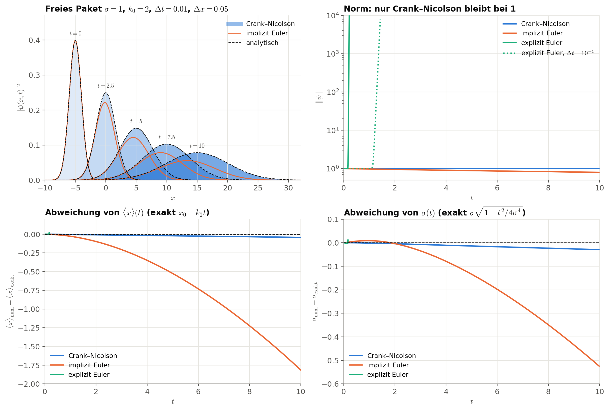{width=100%}

**Warum erhält nur Crank–Nicolson die Norm?**
Die exakte Zeitentwicklung $e^{-iH\Delta t}$ ist unitär, weil $H$ hermitesch ist. Crank–Nicolson ist die Cayley-Transformation $(1 + \frac{i\Delta t}{2}H)^{-1}(1 - \frac{i\Delta t}{2}H)$; Zähler und Nenner sind zueinander konjugiert, also ist sie für jedes $\Delta t$ exakt unitär. Gemessen: $\bigl|\|\psi\| - 1\bigr| < 4\cdot10^{-14}$ über 1000 Schritte.

- **Expliziter Euler** ist für die Schrödinger-Gleichung bei jedem $\Delta t$ instabil, $|g| > 1$ für jedes $\lambda \ne 0$. Norm $1{,}9\cdot10^4$ schon bei $t = 0{,}22$; mit $\Delta t = 10^{-4}$ ist sie bei $t = 1{,}17$ auf 2 gewachsen.
- **Impliziter Euler** dämpft, die hohen Moden am stärksten: Norm **0,798** bei $t = 10$, das Paket ist zu langsam ($\langle x\rangle$ um 1,8 zu klein) und zu schmal ($\sigma$ um 0,53).
- **Crank–Nicolson:** $\langle x\rangle$ um 0,043 und $\sigma$ um 0,029 zu klein. Der Rest kommt fast ganz vom Gitter.

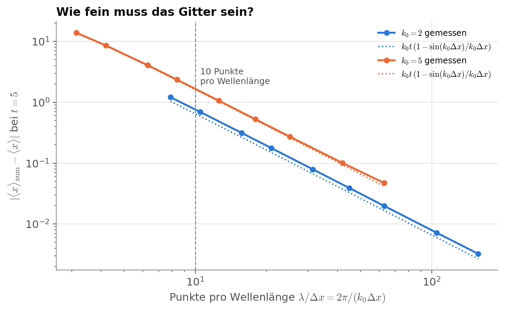{width=62%}

**Wie fein muss das Gitter für ein gegebenes $k_0$ sein?**
Das Paket läuft mit der Gruppengeschwindigkeit des Gitters $v_{\rm FD} = \sin(k_0\Delta x)/\Delta x = k_0\bigl(1 - (k_0\Delta x)^2/6 + \dots\bigr)$, also zu langsam. Der relative Fehler im Laufweg ist $(k_0\Delta x)^2/6$, für beide $k_0$ auf derselben Kurve:

- Harte Grenze $k_0\Delta x < \pi$, mindestens 2 Punkte pro Wellenlänge.
- 6,6 % Fehler bei 10 Punkten pro Wellenlänge, 1,6 % bei 20, 0,4 % bei 40. Faustregel **$\Delta x \lesssim \lambda/20$**, also $\Delta x \propto 1/k_0$.
- Auch $k_0^2\Delta t/2 \ll 1$, sonst stimmt die Phase pro Schritt nicht.

## 2b) Harmonischer Oszillator, Grundzustand verschoben nach $x_0 = 3$

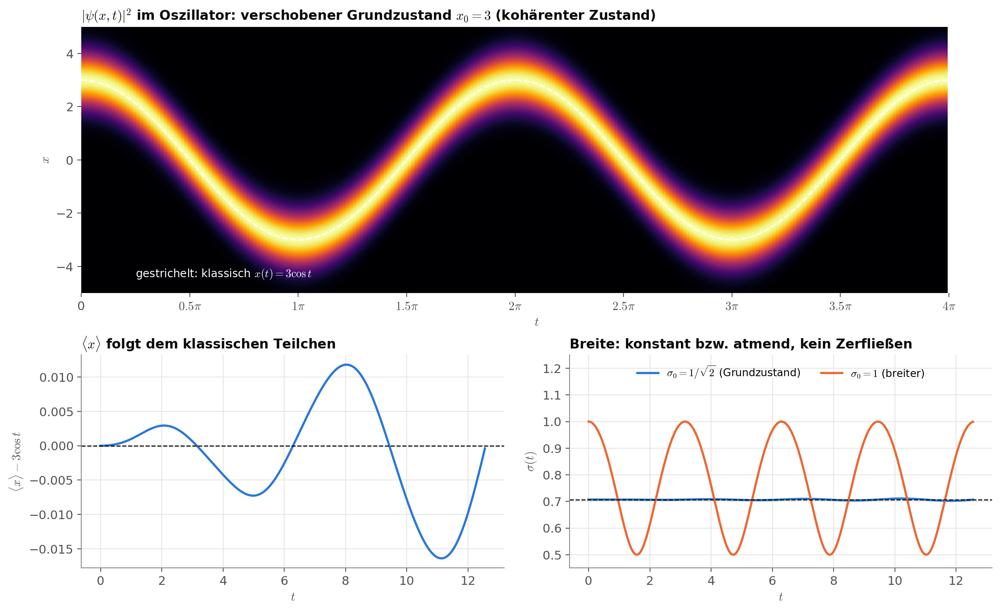{width=100%}

**$\langle x\rangle(t)$ gegen ein klassisches Teilchen.**
Nach Ehrenfest ist $\frac{d^2}{dt^2}\langle x\rangle = -\langle V'(x)\rangle = -\langle x\rangle$, für ein quadratisches Potential exakt. Also $\langle x\rangle = 3\cos t$ wie klassisch; gemessene Abweichung über zwei Perioden höchstens **0,016**.

**Zerfließt das Paket?**
Nein. Der verschobene Grundzustand ist ein kohärenter Zustand: Er bleibt eine Gaußglocke gleicher Breite, gemessen $\sigma \in [0{,}702;\ 0{,}711]$, exakt $1/\sqrt{2} = 0{,}7071$. Ein breiteres Paket ($\sigma_0 = 1$) atmet mit doppelter Frequenz zwischen 0,50 und 1,00, zerfließt aber auch nicht. Grund: Die Energien $n + \frac{1}{2}$ sind äquidistant, nach $2\pi$ wiederholt sich die Bewegung exakt.

## 2c) Unendlicher Topf: Wiederkehr

{width=100%}

**Was passiert bei $T_{\rm rev} = 4/\pi$, und warum?**
Das Paket ist wieder da, Überlapp $|\langle\psi_0|\psi(T_{\rm rev})\rangle|^2 = 0{,}99999$. Mit $\psi(t) = \sum_n c_n e^{-iE_nt}\sin(n\pi x)$ und $E_n = n^2\pi^2/2$ ist $E_nT_{\rm rev} = 2\pi n^2$: Alle Phasen sind gleichzeitig 1.

**Was passiert bei $T_{\rm rev}/2$?**
Die Phasen sind $e^{-i\pi n^2} = (-1)^n$. Wegen $\sin(n\pi(1-x)) = (-1)^{n+1}\sin(n\pi x)$ wird $\psi(x) \to -\psi_0(1-x)$: das Spiegelbild bei $x = 0{,}7$ (Überlapp 0,999998). Bei $T_{\rm rev}/4$ entstehen zwei halbe Kopien bei 0,3 und 0,7 (je 0,5000).

Numerisch braucht die Wiederkehr die Phasen bis $n \approx 15$ auf Bruchteile von $2\pi$ genau. Daher das feine Gitter, $\Delta x = 5\cdot10^{-4}$ und $\Delta t = 3\cdot10^{-5}$.

## 2d) Tunneln und Randbedingungen

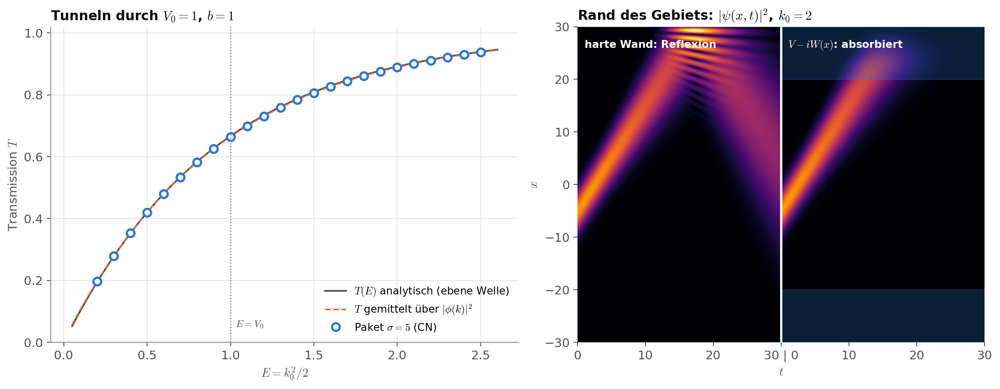{width=100%}

Paket $\sigma = 5$ bei $x_0 = -60$, Barriere $V_0 = 1$ auf genau 20 Gitterpunkten ($b = 1$). Transmittiert ist, was am Ende rechts der Barriere liegt, plus was der rechte Absorber geschluckt hat.

**Vergleich mit der Formel.**
Auf wenige $10^{-3}$, z. B. $T(0{,}5) = 0{,}4197$ gegen $0{,}4200$. Der Rest kommt von der Impulsbreite $1/(2\sigma) = 0{,}1$ des Pakets; über $|\phi(k)|^2$ gemittelt weicht die Formel höchstens $6\cdot10^{-4}$ ab. Unter $E = V_0$ tunneln 20 bis 66 %, weil die Barriere mit $\kappa b < 1{,}3$ dünn ist.

**Was passiert am Ende des Gebiets?**
$\psi = 0$ ist eine unendlich hohe Wand: Das Paket wird vollständig reflektiert, interferiert mit sich selbst und läuft zurück ins Gebiet.

**Wie hilft $V - iW(x)$?**
$H$ ist dann nicht mehr hermitesch, und
$$\frac{d}{dt}\int|\psi|^2\,dx = -2\int W(x)\,|\psi|^2\,dx \le 0.$$
Wo $W > 0$ ist, verschwindet Wahrscheinlichkeit. $W$ steigt in einer Randschicht der Breite 10 quadratisch von 0 auf 2 an: sanft, weil ein steiles $W$ selbst reflektiert, und lang genug, damit die Welle hin und zurück fast ganz geschluckt wird. Übrig bleiben $5\cdot10^{-5}$; das Gebiet ist nach außen offen.

# 3 Schrödinger-Gleichung in 2D

$\psi_{ij}$ zeilenweise als Vektor, $H = H_x \otimes I + I \otimes H_y + \mathrm{diag}(V)$. Crank–Nicolson faktorisiert $1 + \frac{i\Delta t}{2}H$ einmal mit `splu`; ein Schritt auf $440 \times 300$ Punkten kostet dann etwa 20 ms. Absorber an allen vier Rändern.

## 3a) Doppelspalt

Paket $k_0 = 5$ ($\lambda = 1{,}257$), $\sigma_x = 1{,}5$, $\sigma_y = 4$; Wand $V = 200$, Dicke 0,5, Spalte der Breite 1 bei $y = \pm 2$. Gitter $\Delta x = 0{,}1$, $\Delta t = 0{,}01$. Am Schirm $L = 15$ hinter der Wand wird $\int|\psi|^2\,dt$ aufsummiert.

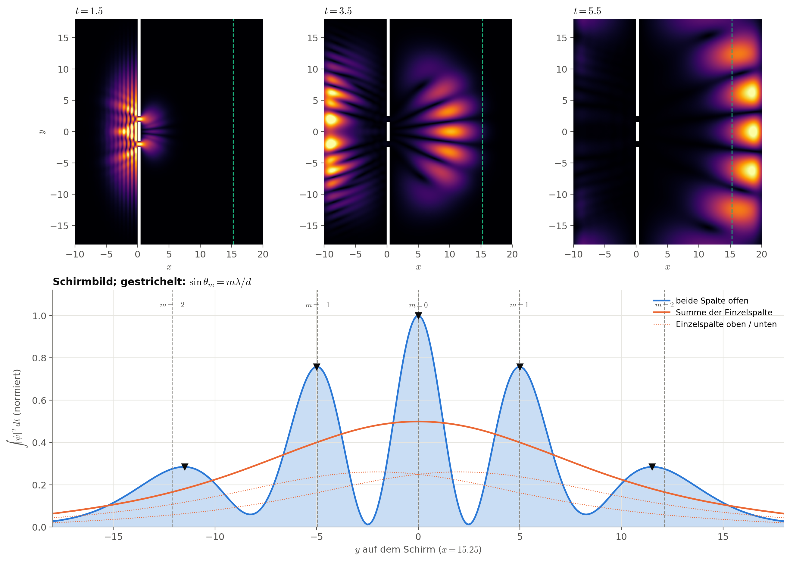{width=100%}

**Vergleich der Maxima mit $\sin\theta_m = m\lambda/d$** ($\theta = \arctan(y/L)$):

| $m$ | $0$ | $\pm 1$ | $\pm 2$ |
|:--|:--:|:--:|:--:|
| Theorie $m\lambda/d$ | $0$ | $\pm 0{,}314$ | $\pm 0{,}628$ |
| gemessen | $0$ | $\pm 0{,}316$ ($y = \pm 5{,}0$) | $\pm 0{,}608$ ($y = \pm 11{,}5$) |

Die zweite Ordnung liegt 3 % innen: Der Schirm ist kaum im Fernfeld ($L = 15$ gegen $d^2/\lambda = 12{,}7$), und die Einhüllende des Einzelspalts zieht die äußeren Maxima nach innen.

**Was gibt die Summe der beiden Einzelspalte, und warum?**
Eine breite Glocke ohne Streifen. Es addieren sich Amplituden, nicht Wahrscheinlichkeiten:
$$|\psi_1 + \psi_2|^2 = |\psi_1|^2 + |\psi_2|^2 + 2\,\mathrm{Re}(\psi_1^*\psi_2).$$
Die Summe der Einzelbilder hat nur die ersten beiden Terme. Die Streifen sind der Interferenzterm, und den gibt es nur, wenn beide Wege gleichzeitig offen sind.

## 3b) Mach–Zehnder-Interferometer

Alle Barrieren liegen waagrecht auf Gitterlinien, das Paket ($k_0 = 8$, $\sigma = 1$) läuft unter 45°. Strahlteiler BS1 bei $(0, 0)$, Spiegel ($V = 1000$) bei $(6, \pm 6)$, BS2 bei $(12, 0)$. Gitter $\Delta x = 0{,}08$, $\Delta t = 0{,}004$, $474 \times 299$ Punkte.

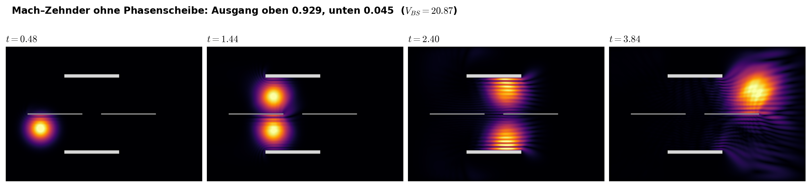{width=100%}

**Höhe des Strahlteilers.**
Eine waagrechte Barriere wirkt nur auf die $y$-Bewegung, das 2D-Problem zerfällt exakt. Sie sieht $E_\perp = k_y^2/2 = 16$. Die Formel aus 2d gibt $T = \frac{1}{2}$ bei $V = 21{,}32$; auf dem Gitter (Barriere = 3 Punkte) per 1D-Bisektion **$V_{\rm BS} = 20{,}87$**. In 2D gemessen $T = 0{,}472$, $R = 0{,}509$.

**Welchen Ausgang nimmt das Teilchen?**
Ohne Scheibe **93 % oben, 4,5 % unten**. Oben kommen die Amplituden $tr$ und $rt$ an, unten $t^2$ und $r^2$. Bei einer symmetrischen Barriere ist $r/t$ rein imaginär, also
$$P_{\rm unten} \propto |t^2 + r^2|^2 = (|t|^2 - |r|^2)^2 = 0, \qquad P_{\rm oben} \propto 4|r|^2|t|^2 = 1.$$
Der Rest kommt von $T \ne R$; 2,6 % laufen an den Enden der Barrieren vorbei.

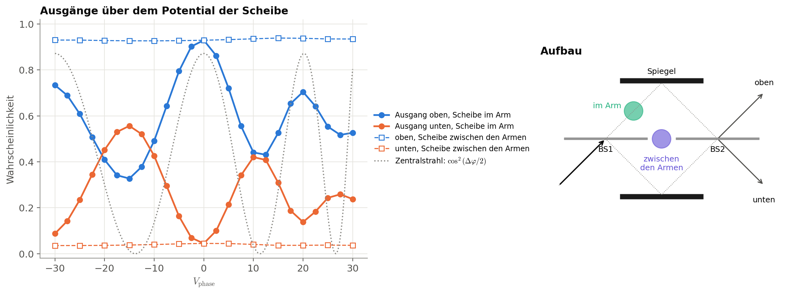{width=88%}

**Scheibe im Arm.**
In der Scheibe ist $k' = \sqrt{k_0^2 - 2V_{\rm phase}}$, der Zentralstrahl sammelt $\Delta\varphi \approx 2(k' - k_0)$ und $P_{\rm oben} \approx \cos^2(\Delta\varphi/2)$. Bei $V_{\rm phase} = -15$ kippt das Interferometer: **unten 0,56, oben 0,33**. Voller Kontrast geht nicht, weil das Paket ($\sigma \approx 1{,}2$) breiter als die Scheibe ist und jeder Teil eine andere Sehnenlänge sieht. Große $|V_{\rm phase}|$ streuen außerdem Teile weg.

**Warum wirkt die Scheibe zwischen den Armen nicht?**
Oben bleibt bei 0,93 bis 0,94. Ein Potential wirkt lokal, $V(x)\psi(x)$. Die Wege laufen 4,2 Einheiten an der Scheibe vorbei, dort ist $\psi \approx 0$.

## 3c) Aharonov–Bohm-Effekt

**Vektorpotential auf dem Gitter (Peierls-Substitution).** Jede Kante bekommt eine Phase,
$$H_{p,\,p+\mathbf e} = -\frac{1}{2\Delta x^2}\exp\bigl(-iq\,A_e\,\Delta x\bigr),$$
mit $A_e$ an der Kantenmitte, die Gegenrichtung konjugiert. Die Tests prüfen: Konstantes $\mathbf A$ lässt das Spektrum exakt gleich (reine Eichung), und ein Paket mit Impuls $k_0$ hat die Energie $(k_0 - qA_x)^2/2$. Die Spule ($r_0 = 1$, $q = 1$) sitzt bei $(6, 0)$ zwischen den Armen, $\Phi = \pi B_0 r_0^2$.

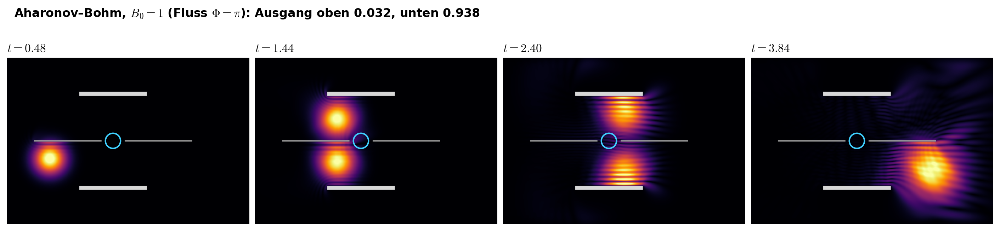{width=100%}

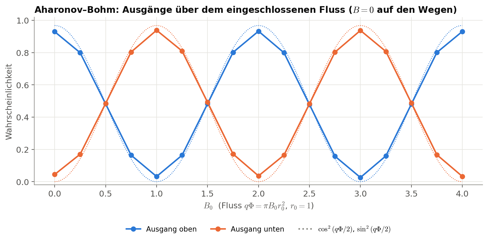{width=88%}

**Ergebnis.** $P_{\rm oben} = \cos^2(q\Phi/2)$ mit **Periode $B_0 = 2$**, also $\Phi = 2\pi/q$. Bei $B_0 = 1$ ($\Phi = \pi$) sind die Ausgänge vertauscht: **oben 0,032, unten 0,938**. Bei $B_0 = 2$ wie ohne Feld (oben 0,933).

**Warum ändern sich die Ausgänge, obwohl $\mathbf B = 0$ überall dort ist, wo das Teilchen sein kann?**
Auf einem Weg sammelt die Wellenfunktion die Phase $q\int\mathbf A\cdot d\mathbf l$. Die Differenz der beiden Wege ist
$$\Delta\varphi = q\oint\mathbf A\cdot d\mathbf l = q\iint\mathbf B\cdot d\mathbf S = q\Phi.$$
Sie ist eichinvariant und hängt nur vom eingeschlossenen Fluss ab. Klassisch zählt nur die Lorentzkraft am eigenen Ort, und dort ist $\mathbf B = 0$. Anders als das skalare Potential in 3b, das nur lokal wirkt, vertauscht die Spule an derselben Stelle die Ausgänge.

**Könnte $\mathbf A$ außerhalb eines beschränkten Gebiets verschwinden?**
Nein. Für jede Schleife um die Spule gilt nach Stokes $\oint\mathbf A\cdot d\mathbf l = \Phi \ne 0$, in jeder Eichung. Außerhalb eines beschränkten Gebiets gibt es beliebig große Kreise um die Spule; wäre $\mathbf A$ dort null, wäre das Integral null. Eine Eichung kann $\mathbf A$ nur verschieben, nicht entfernen.
