# Exercise 6 · Schrödinger-Gleichung

**Computational Physics, WS 2026/27 · 18.11.2026 · Emil Ohligs**

Einheiten $\hbar = m = 1$. Alles läuft über **eine** Idee: Der Hamilton-Operator wird mit finiten Differenzen zu einer dünnen Matrix $H$. Teil 1 sucht ihre Eigenwerte, Teil 2 integriert $i\,\partial_t\psi = H\psi$ in der Zeit, Teil 3 macht dasselbe in 2D und mit Magnetfeld.

| Datei | Inhalt |
|---|---|
| `schroedinger.py` | Gitter, $H$ in 1D/2D (mit Vektorpotential), Eigenzustände, Zeitschritte, analytische Vergleichsformeln |
| `test_schroedinger.py` | 28 Tests, die jede Funktion gegen eine bekannte Eigenschaft prüfen |
| `figures.py` | alle Simulationen; `python figures.py 2c` erzeugt z. B. nur Teil 2c |
| `results.json` | alle Zahlen, die hier im Text stehen |
| `*.png`, `*.gif` | Abbildungen; die GIFs für die Präsentation |

> **Die Ergebnisse auf einen Blick**
>
> - **1a** Oszillator: 47 Niveaus auf $10^{-3}$ genau ($\Delta x = 0{,}02$, $L = 10$). Grenzen: Gitter (Fehler $\propto \Delta x^2 n^2$) und Kastenrand.
> - **1b** Topf: Fehler $\approx (n\pi\Delta x)^2/12$, gemessene Ordnung **2,000**.
> - **1c** Endlicher Topf $V_0 = 10$, $a = 1$: **3 gebundene Zustände**.
> - **2a** Nur **Crank–Nicolson** erhält die Norm ($|\,\|\psi\|-1| < 4\cdot10^{-14}$). Explizit Euler explodiert, implizit Euler dämpft. Faustregel: **≥ 20 Gitterpunkte pro Wellenlänge**.
> - **2b** Kohärenter Zustand: $\langle x\rangle$ folgt $3\cos t$, Breite bleibt $1/\sqrt2$, **kein Zerfließen**.
> - **2c** Topf: perfekte Wiederkehr bei $T_{\rm rev} = 4/\pi$ (Überlapp 0,99999), Spiegelbild bei $T_{\rm rev}/2$.
> - **2d** Tunneln: Simulation und Formel stimmen auf $6\cdot10^{-4}$ überein; ein komplexes Potential $-iW$ schluckt die Welle am Rand.
> - **3a** Doppelspalt: Maxima bei $\sin\theta = 0,\ \pm0{,}316,\ \pm0{,}608$ (Theorie $0,\ \pm0{,}314,\ \pm0{,}628$). Einzelspalte addiert: **keine Streifen**.
> - **3b** Mach–Zehnder: 93 % im Ausgang „oben“, 4,5 % „unten“. Eine Potentialscheibe im Arm verschiebt die Phase und kippt die Ausgänge; dieselbe Scheibe **zwischen** den Armen wirkt nicht.
> - **3c** Aharonov–Bohm: Eine Spule zwischen den Armen vertauscht die Ausgänge, obwohl $B = 0$ auf beiden Wegen: $P_{\rm oben} = \cos^2(q\Phi/2)$, Periode $\Phi = 2\pi$.

---

## 0 · Das Werkzeug: $H$ als Matrix

Auf einem Gitter $x_j = a + j\,\Delta x$ ($j = 1\dots N$) mit $\psi = 0$ an beiden Enden (harte Wände) wird die zweite Ableitung zum 3-Punkte-Stern aus Exercise 5:

$$
H\psi\big|_j = -\frac{1}{2}\,\frac{\psi_{j-1} - 2\psi_j + \psi_{j+1}}{\Delta x^2} + V_j\,\psi_j,
\qquad
H = -\frac{1}{2\Delta x^2}\,\mathrm{tridiag}(1,\,-2,\,1) + \mathrm{diag}(V)
$$

$H$ ist reell-symmetrisch (für reelles $V$), tridiagonal und dünn besetzt. Die Eigenwerte holt `scipy.linalg.eigh_tridiagonal` direkt, ohne die volle Matrix.

**Was ein Gitter überhaupt darstellen kann.** Eine ebene Welle $e^{ikx}$ sieht auf dem Gitter die Energie

$$
E_{\rm FD}(k) = \frac{1 - \cos(k\Delta x)}{\Delta x^2} = \frac{k^2}{2}\Bigl(1 - \frac{(k\Delta x)^2}{12} + \dots\Bigr)
$$

statt $k^2/2$. Fast alle Genauigkeitsfragen dieses Blatts sind Folgen dieser einen Formel: Je mehr Gitterpunkte auf eine Wellenlänge kommen ($k\Delta x$ klein), desto besser.

---

## 1 · Stationäre Schrödinger-Gleichung $H\psi = E\psi$

### 1a) Harmonischer Oszillator $V = x^2/2$, exakt $E_n = n + \tfrac12$

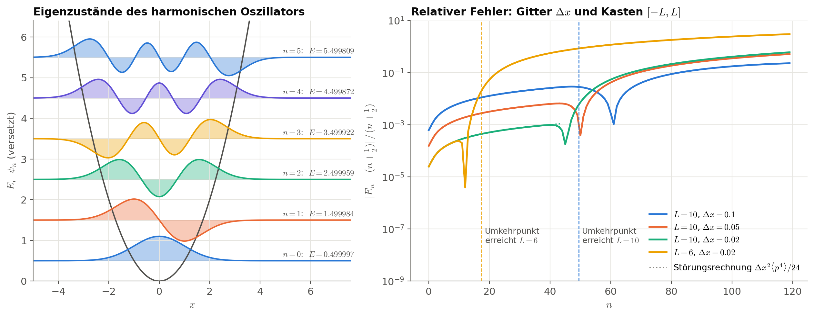

**Was ich gemacht habe.** $H$ auf $[-L, L]$ aufgestellt und die untersten 120 Eigenwerte für vier Kombinationen aus Gitter $\Delta x$ und Kastengröße $L$ berechnet.

**Welche Niveaus sind genau?** Die tiefen. Bei $\Delta x = 0{,}02$, $L = 10$ ist $E_0 = 0{,}4999875$ (Fehler $1{,}25\cdot10^{-5}$), und die Niveaus $n = 0 \dots 46$ liegen unter $10^{-3}$ relativem Fehler.

**Was begrenzt die Genauigkeit?** Zwei verschiedene Dinge, im rechten Bild klar zu trennen:

1. **Das Gitter.** Höhere Zustände schwingen schneller, ihre lokale Wellenzahl ist größer, und $E_{\rm FD}(k)$ liegt unter $k^2/2$. Mit $\Delta x^2/24\cdot p^4$ als Störung folgt
   $$\Delta E_n \approx -\frac{\Delta x^2}{24}\langle p^4\rangle = -\frac{\Delta x^2}{32}\,(2n^2 + 2n + 1)$$
   Für $n = 0$ gibt das genau $\Delta x^2/32 = 1{,}25\cdot10^{-5}$, wie gemessen (gepunktete Linien). Halbes $\Delta x$ → Viertel des Fehlers.
2. **Der Kasten.** Der klassische Umkehrpunkt liegt bei $x = \sqrt{2n+1}$. Sobald er die Wand $L$ erreicht ($n \approx (L^2-1)/2$, also 49,5 für $L = 10$ und 17,5 für $L = 6$), quetscht die Wand den Zustand, die Energie steigt steil an und geht in das $n^2$-Spektrum eines Kastens über. Für $L = 6$ sind darum trotz feinem Gitter nur 14 Niveaus gut.

Der scharfe Knick im Fehler ist kein Glück: Dort wechselt der Fehler das Vorzeichen (Gitter macht $E$ zu klein, Wand macht $E$ zu groß).

### 1b) Unendlicher Topf auf $[0, 1]$, exakt $E_n = n^2\pi^2/2$

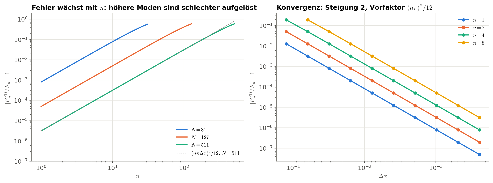

**Was ich gemacht habe.** $V = 0$, $N = 2^k - 1$ innere Punkte, alle $N$ Eigenwerte.

**Wie hängt der Fehler von $n$ und $\Delta x$ ab?** Hier ist das Gitterspektrum exakt bekannt, die Eigenvektoren sind die abgetasteten Sinus $\sin(n\pi x_j)$:

$$
E_n^{\rm FD} = \frac{2}{\Delta x^2}\sin^2\!\Bigl(\frac{n\pi\Delta x}{2}\Bigr)
\quad\Rightarrow\quad
\frac{E_n^{\rm FD}}{E_n} - 1 \approx -\frac{(n\pi\Delta x)^2}{12}
$$

- **In $\Delta x$:** quadratisch. Gemessene Steigung **2,000** für $n = 1, 2, 4, 8$ (rechts).
- **In $n$:** ebenfalls quadratisch, denn $n\pi\Delta x$ ist der Phasenschritt pro Gitterpunkt. Für $n \to N$ sättigt das Spektrum bei $2/\Delta x^2$, der Fehler wird von der Ordnung 1 (links): Die obersten Zustände haben nur noch 2 Punkte pro Wellenlänge.
- Faustregel: Der relative Fehler eines Niveaus hängt nur davon ab, wie viele Punkte pro Wellenlänge es hat.

### 1c) Endlicher Topf $V = -V_0 = -10$ für $|x| < a = 1$

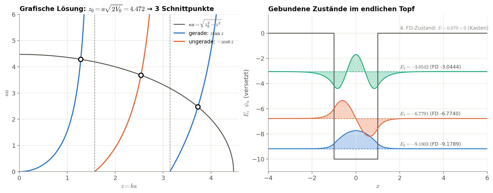

**Analytisch.** Innen $\psi \sim \cos kx$ bzw. $\sin kx$ mit $k = \sqrt{2(E+V_0)}$, außen $e^{-\kappa|x|}$ mit $\kappa = \sqrt{-2E}$. Stetigkeit von $\psi'/\psi$ bei $x = a$ gibt
$$k\tan ka = \kappa \ \ (\text{gerade}),\qquad -k\cot ka = \kappa \ \ (\text{ungerade}).$$
Mit $z = ka$ und $z_0 = a\sqrt{2V_0}$ ist $(\kappa a)^2 = z_0^2 - z^2$, also ein Viertelkreis. Jede Schnittstelle mit einem Ast ist ein gebundener Zustand (links). Ich löse beide Gleichungen mit `brentq` in der polfreien Form $z\sin z = \sqrt{z_0^2-z^2}\cos z$.

**Wie viele gebundene Zustände?** Alle $\pi/2$ beginnt ein neuer Ast, also
$$N_{\rm geb} = \Bigl\lceil \frac{z_0}{\pi/2} \Bigr\rceil = \lceil 2{,}847\rceil = \mathbf{3}.$$

| Zustand | analytisch | FD ($\Delta x = 0{,}002$) |
|---|---|---|
| $E_0$ (gerade) | $-9{,}1803$ | $-9{,}1789$ |
| $E_1$ (ungerade) | $-6{,}7791$ | $-6{,}7740$ |
| $E_2$ (gerade) | $-3{,}0542$ | $-3{,}0444$ |

Die Abweichung ist größer als beim Oszillator, weil $V$ an $x = \pm a$ springt und die Sprungstelle nur auf $\pm\Delta x$ genau auf dem Gitter liegt. Der vierte FD-Zustand hat $E = +0{,}079 > 0$: Das ist kein gebundener Zustand, sondern ein Kastenzustand des Rechengebiets $[-8, 8]$.

---

## 2 · Zeitabhängige Schrödinger-Gleichung $i\,\partial_t\psi = H\psi$

Gauß-Paket $\psi_0 \propto e^{-(x-x_0)^2/(4\sigma^2) + ik_0x}$; $\sigma$ ist die Breite von $|\psi|^2$, $k_0$ der mittlere Impuls.

### 2a) Freies Paket ($\sigma = 1$, $k_0 = 2$): drei Zeitschritte

Für einen Eigenvektor von $H$ mit Eigenwert $\lambda$ multipliziert jeder Schritt die Amplitude mit

| Verfahren | Schritt | Verstärkung $g(\lambda)$ | $\lvert g\rvert$ |
|---|---|---|---|
| explizit Euler | $\psi^{n+1} = (1 - i\Delta t H)\psi^n$ | $1 - i\lambda\Delta t$ | $\sqrt{1 + \lambda^2\Delta t^2} > 1$ |
| implizit Euler | $(1 + i\Delta t H)\psi^{n+1} = \psi^n$ | $\dfrac{1}{1 + i\lambda\Delta t}$ | $\dfrac{1}{\sqrt{1+\lambda^2\Delta t^2}} < 1$ |
| Crank–Nicolson | $(1 + \tfrac{i\Delta t}{2}H)\psi^{n+1} = (1 - \tfrac{i\Delta t}{2}H)\psi^n$ | $\dfrac{1 - i\lambda\Delta t/2}{1 + i\lambda\Delta t/2}$ | $= 1$ exakt |

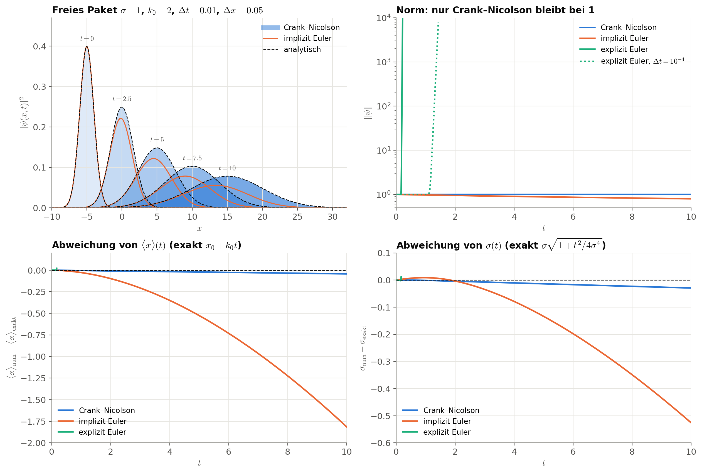

**Was ich gemacht habe.** Gitter $[-20, 40]$, $\Delta x = 0{,}05$, $\Delta t = 0{,}01$ bis $t = 10$; Norm, $\langle x\rangle$ und $\sigma$ gegen die exakte Lösung $\langle x\rangle = x_0 + k_0t$, $\sigma(t) = \sigma\sqrt{1 + t^2/(4\sigma^4)}$.

**Warum erhält nur Crank–Nicolson die Norm?** Die exakte Zeitentwicklung $e^{-iH\Delta t}$ ist unitär, weil $H$ hermitesch ist; alle Eigenwerte liegen auf dem Einheitskreis. Crank–Nicolson ist die **Cayley-Transformation** $(1 + \tfrac{i\Delta t}{2}H)^{-1}(1 - \tfrac{i\Delta t}{2}H)$: Zähler und Nenner sind zueinander komplex konjugiert, darum ist sie für jedes $\Delta t$ exakt unitär. Beide Euler-Verfahren sind nur erste Ordnung und liegen neben dem Einheitskreis:

- **Explizit Euler ist für Schrödinger immer instabil**, egal wie klein $\Delta t$: $|g| > 1$ für jeden Eigenwert $\lambda \neq 0$. Die höchste Gittermode $\lambda_{\max} \approx 2/\Delta x^2 = 800$ wächst mit Faktor $\sqrt{1 + 8^2} \approx 8$ pro Schritt aus dem Rundungsrauschen heraus. Gemessen: Norm $1{,}9\cdot10^4$ schon bei $t = 0{,}22$. Mit $\Delta t = 10^{-4}$ dauert es länger, die Norm ist trotzdem bei $t = 1{,}17$ auf 2 gewachsen.
- **Implizit Euler dämpft** jede Mode, die hohen am stärksten. Norm bei $t = 10$: **0,798**. Das Paket wird zu langsam und zu schmal ($\langle x\rangle$ um 1,8 zu klein, $\sigma$ um 0,53 zu klein).
- **Crank–Nicolson:** $\bigl|\|\psi\| - 1\bigr| < 4\cdot10^{-14}$ über 1000 Schritte, Fehler bei $t = 10$: $\langle x\rangle$ um 0,043, $\sigma$ um 0,029 zu klein. Dieser Rest kommt fast ganz vom Gitter, siehe unten.

**Wie fein muss das Gitter für ein gegebenes $k_0$ sein?** Das Paket läuft mit der Gruppengeschwindigkeit des Gitters
$$v_{\rm FD} = \frac{dE_{\rm FD}}{dk} = \frac{\sin(k_0\Delta x)}{\Delta x} = k_0\Bigl(1 - \frac{(k_0\Delta x)^2}{6} + \dots\Bigr),$$
also zu langsam, und der Ortsfehler wächst wie $k_0t\,(k_0\Delta x)^2/6$.

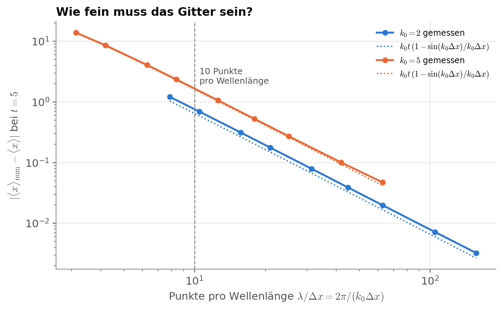

Die Messung liegt genau auf dieser Vorhersage, für $k_0 = 2$ und $k_0 = 5$ auf derselben Kurve, wenn man über **Punkte pro Wellenlänge** $\lambda/\Delta x = 2\pi/(k_0\Delta x)$ aufträgt. Daraus:

- **Harte Grenze:** $k_0\Delta x < \pi$ (mindestens 2 Punkte pro Wellenlänge, Nyquist), sonst kann das Gitter die Welle gar nicht darstellen.
- **Praktisch:** Der relative Fehler im Laufweg ist $(k_0\Delta x)^2/6$: 6,6 % bei 10 Punkten pro Wellenlänge, 1,6 % bei 20, 0,4 % bei 40. **$\Delta x \lesssim \lambda/20$**, also $\Delta x \propto 1/k_0$.
- Auch $\Delta t$ muss zu $k_0$ passen: Crank–Nicolson dreht die Phase um $2\arctan(E\Delta t/2)$ statt $E\Delta t$, also $E\Delta t = k_0^2\Delta t/2 \ll 1$.

### 2b) Harmonischer Oszillator: Grundzustand verschoben nach $x_0 = 3$

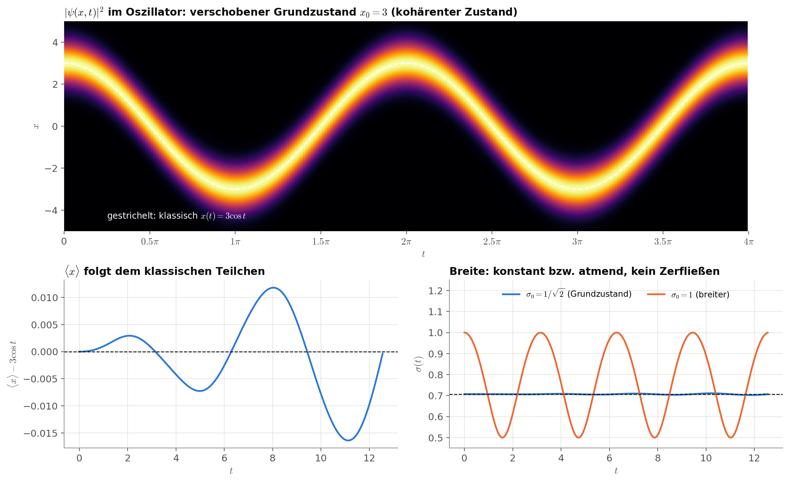

**Was ich gemacht habe.** Grundzustand $\sigma = 1/\sqrt2$, $k_0 = 0$, bei $x_0 = 3$ gestartet, CN mit $\Delta t = 0{,}005$ über zwei Perioden ($4\pi$).

**$\langle x\rangle$ gegen das klassische Teilchen.** Nach Ehrenfest gilt $\frac{d^2}{dt^2}\langle x\rangle = -\langle V'(x)\rangle = -\langle x\rangle$, für ein quadratisches Potential **exakt**. Also $\langle x\rangle = 3\cos t$ wie klassisch. Gemessene Abweichung über zwei Perioden: höchstens **0,016**, und sie wächst langsam, weil das Gitter die Frequenz minimal verschiebt.

**Zerfließt das Paket?** Nein. Die verschobene Grundzustandsfunktion ist ein **kohärenter Zustand**: Er bleibt eine Gaußglocke mit derselben Breite, nur ihr Mittelpunkt schwingt. Gemessen $\sigma \in [0{,}702;\ 0{,}711]$, exakt $0{,}7071$. Zum Vergleich ein breiteres Paket ($\sigma_0 = 1$): Es **atmet** mit doppelter Frequenz zwischen $0{,}50$ und $1{,}00$ (gequetschter Zustand), zerfließt aber auch nicht. Der Grund: Die Energien $n + \tfrac12$ sind äquidistant, also ist die Bewegung nach $2\pi$ wieder exakt die gleiche. Beim freien Teilchen ($E \propto k^2$) gibt es so eine Periode nicht.

### 2c) Unendlicher Topf: Wiederkehr (Revival)

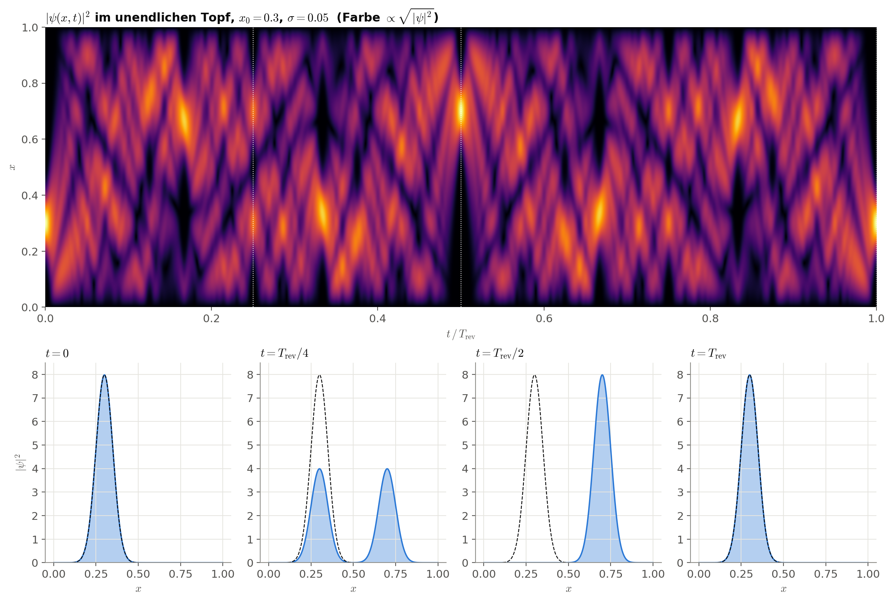

**Was ich gemacht habe.** Schmales Paket $x_0 = 0{,}3$, $\sigma = 0{,}05$, $k_0 = 0$ auf $[0, 1]$ mit 1999 Punkten, CN mit $\Delta t = T_{\rm rev}/40\,000$. Bild oben: $|\psi(x,t)|^2$ (Farbe $\propto \sqrt{|\psi|^2}$, damit man die schwachen Teile sieht).

**Was passiert bei $T_{\rm rev} = 4/\pi$?** Das Paket ist wieder **genau da**, Überlapp $|\langle\psi_0|\psi(T_{\rm rev})\rangle|^2 = 0{,}99999$. Dazwischen zerfließt es zu einem scheinbar chaotischen Teppich (Quanten-Teppich).

**Warum?** Entwickelt nach Eigenzuständen ist $\psi(t) = \sum_n c_n\,e^{-iE_nt}\sin(n\pi x)$ mit $E_n = n^2\pi^2/2$. Bei $t = T_{\rm rev}$ ist
$$E_nT_{\rm rev} = \frac{n^2\pi^2}{2}\cdot\frac{4}{\pi} = 2\pi n^2,$$
also sind **alle** Phasen gleichzeitig $1$. Das geht nur, weil alle $E_n$ ganzzahlige Vielfache von $\pi^2/2$ sind.

**Und bei $T_{\rm rev}/2$?** Die Phasen sind $e^{-i\pi n^2} = (-1)^n$. Wegen $\sin(n\pi(1-x)) = (-1)^{n+1}\sin(n\pi x)$ wird daraus $\psi(x) \to -\psi_0(1-x)$: das **Spiegelbild** bei $x = 0{,}7$ (Überlapp 0,999998). Bei $T_{\rm rev}/4$ ist die Phase für gerade $n$ gleich 1, für ungerade $-i$: zwei halbe Kopien bei 0,3 und 0,7 (gemessen 0,5000 und 0,5000). Allgemein ist $\psi$ bei jedem rationalen Bruchteil $p/q\cdot T_{\rm rev}$ eine Überlagerung weniger Kopien des Anfangspakets (fraktionale Wiederkehr); im Bild sind das die hellen, geordneten Stellen im sonst ungeordneten Muster.

Numerisch heikel: Die Wiederkehr braucht die Phasen von $n \approx 1\dots 15$ auf Bruchteile von $2\pi$ genau. Das Gitter verfälscht $E_n$ um $(n\pi\Delta x)^2/12$ (1b), und CN die Phase um $(E_n\Delta t)^3/12$ pro Schritt. Darum das feine $\Delta x = 5\cdot10^{-4}$ und $\Delta t = 3\cdot10^{-5}$.

### 2d) Tunneln und Randbedingungen

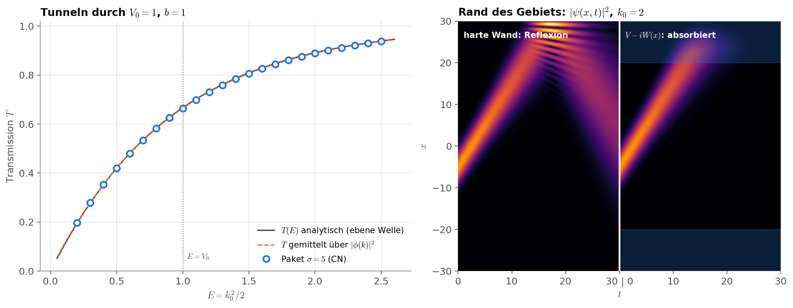

**Was ich gemacht habe.** Barriere $V_0 = 1$ auf $0 < x < 1$, Paket $\sigma = 5$ bei $x_0 = -60$, $E = k_0^2/2 = 0{,}2 \dots 2{,}5$. Transmittiert ist, was am Ende rechts der Barriere ist, plus was der rechte Absorber bis dahin geschluckt hat.

Analytisch für eine ebene Welle ($E < V_0$, für $E > V_0$ wird $\sinh \to \sin$ und $V_0 - E \to E - V_0$):
$$T = \Bigl[1 + \frac{V_0^2\sinh^2(\kappa b)}{4E(V_0 - E)}\Bigr]^{-1},\qquad \kappa = \sqrt{2(V_0 - E)}$$

**Ergebnis.** Simulation und Formel stimmen auf wenige $10^{-3}$, z. B. $T(0{,}5) = 0{,}4197$ gegen $0{,}4200$. Der Rest ist kein Fehler: Ein Paket mit $\sigma = 5$ hat eine Impulsbreite $1/(2\sigma) = 0{,}1$ und mittelt $T$ über ein Stück der Kurve. Mittelt man die Formel über $|\phi(k)|^2$, ist die Abweichung höchstens $6\cdot10^{-4}$. Unter $E = V_0$ tunneln immerhin 20–66 %, weil die Barriere mit $\kappa b < 1{,}3$ dünn ist.

Eine Gitterfalle: Die Barriere muss **genau** $b/\Delta x = 20$ Gitterpunkte haben. Mit der ersten Version lagen nur 19 darin ($b_{\rm eff} = 0{,}95$), und alle $T$ waren um 0,02 zu groß.

**Was passiert am Ende des Gebiets?** $\psi = 0$ am Rand ist eine **unendlich hohe Wand**: Das Paket wird vollständig reflektiert und interferiert mit sich selbst (Bild rechts, linke Hälfte). Bei einer Streurechnung kommt es dann zurück und verfälscht alles.

**Wie hilft $V - iW(x)$?** Mit einem imaginären Potential ist $H$ nicht mehr hermitesch, und
$$\frac{d}{dt}\int|\psi|^2\,dx = -2\int W(x)\,|\psi|^2\,dx \le 0.$$
Wo $W > 0$ ist, verschwindet Wahrscheinlichkeit. Ich lasse $W$ in einer Randschicht der Breite 10 quadratisch von 0 auf 2 ansteigen (`absorber`). Sanft, weil ein steiler Sprung in $W$ selbst wieder reflektiert; lang genug, damit die Welle auf dem Weg hinein und zurück fast ganz geschluckt wird. Übrig bleiben $5\cdot10^{-5}$ (Bild rechts, rechte Hälfte). Das Gebiet wirkt dadurch nach außen offen.

---

## 3 · Schrödinger-Gleichung in 2D

**Erweiterung.** $\psi_{ij}$ auf einem Gitter $x_i, y_j$, zeilenweise zu einem Vektor; der Laplace wird die Kronecker-Summe aus Exercise 5:
$$H = H_x\otimes I + I\otimes H_y + \mathrm{diag}(V).$$
Crank–Nicolson braucht pro Schritt ein dünnes lineares System. Die Matrix $1 + \tfrac{i\Delta t}{2}H$ wird **einmal** mit `splu` faktorisiert, danach kostet ein Schritt auf $440 \times 300$ Punkten etwa 20 ms. Absorber an allen vier Rändern.

### 3a) Doppelspalt

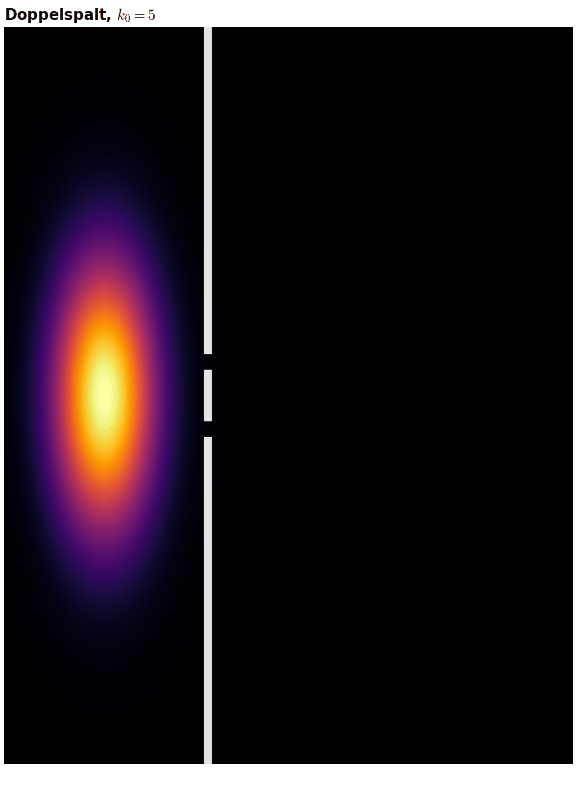

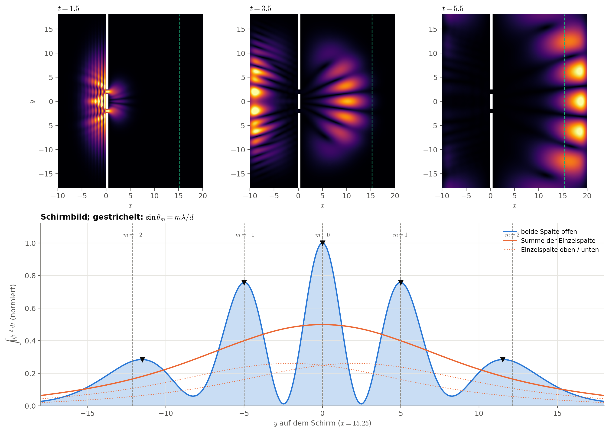

**Was ich gemacht habe.** Paket $k_0 = 5$ ($\lambda = 2\pi/k_0 = 1{,}257$), $\sigma_x = 1{,}5$, $\sigma_y = 4$ (beleuchtet beide Spalte gleich), Wand $V = 200$ der Dicke 0,5 bei $x = 0$ mit zwei Spalten der Breite 1 bei $y = \pm2$ ($d = 4$). Gitter $\Delta x = 0{,}1$ (12,6 Punkte pro Wellenlänge), $\Delta t = 0{,}01$. Ein Spalt hat 9 offene Gitterpunkte; der Abstand zwischen den letzten Wandpunkten ist 1,0, die offene Fläche $9\,\Delta x = 0{,}9$. Auf die Lage der Maxima wirkt sich das nicht aus, nur leicht auf die Einhüllende. Am Schirm $L = 15$ hinter der Wand wird $\int|\psi|^2\,dt$ aufsummiert.

**Maxima gegen $\sin\theta_m = m\lambda/d$** mit $\theta = \arctan(y/L)$:

| $m$ | $0$ | $\pm1$ | $\pm2$ |
|---|---|---|---|
| Theorie $m\lambda/d$ | $0$ | $\pm0{,}314$ | $\pm0{,}628$ |
| gemessen ($y$ am Schirm) | $0$ | $\pm0{,}316$ ($y = \pm5{,}0$) | $\pm0{,}608$ ($y = \pm11{,}5$) |

Die erste Ordnung trifft, die zweite liegt 3 % innen. Gründe: Der Schirm ist nicht im Fernfeld ($L = 15$ ist kaum größer als $d^2/\lambda = 12{,}7$), und die Einhüllende des Einzelspalts fällt nach außen ab und zieht die äußeren Maxima nach innen.

**Was gibt die Summe der beiden Einzelspalte? Warum?** Eine breite Glocke **ohne Streifen** (orange). Gerechnet wird mit Amplituden:
$$|\psi_1 + \psi_2|^2 = |\psi_1|^2 + |\psi_2|^2 + 2\,\mathrm{Re}(\psi_1^*\psi_2).$$
Die Summe der Einzelbilder enthält nur die ersten beiden Terme. Die Streifen sind der Interferenzterm $2\,\mathrm{Re}(\psi_1^*\psi_2)$, und den gibt es nur, wenn **beide** Wege gleichzeitig offen sind, also nicht feststeht, durch welchen Spalt das Teilchen ging. In der Mitte ist das Doppelspaltbild doppelt so hoch wie die Summe, in den Minima fast null.

### 3b) Mach–Zehnder-Interferometer

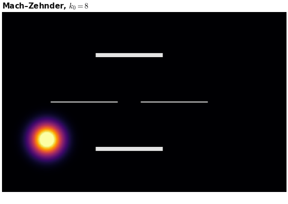

**Aufbau.** Alle Barrieren liegen **waagrecht**, also genau auf Gitterlinien; das Paket ($k_0 = 8$, $\sigma = 1$) läuft unter 45°. Strahlteiler BS1 bei $(0, 0)$, Spiegel (harte Wände, $V = 1000$) bei $(6, \pm6)$, Strahlteiler BS2 bei $(12, 0)$. Gitter $\Delta x = 0{,}08$ (9,8 Punkte pro Wellenlänge), $\Delta t = 0{,}004$, $474 \times 299$ Punkte.

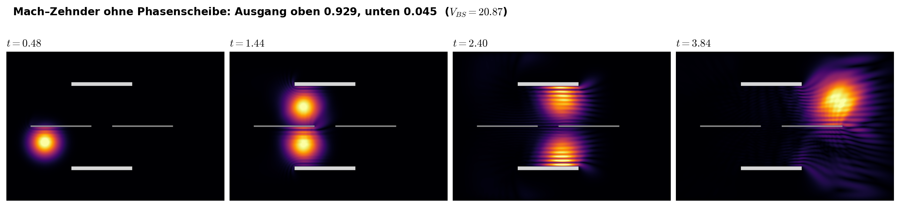

**Höhe des Strahlteilers.** Eine waagrechte Barriere wirkt nur auf die Bewegung in $y$: Weil auch das Paket ein Produkt aus einer Gaußglocke in $x$ und einer in $y$ ist, zerfällt das 2D-Problem **exakt** in zwei 1D-Probleme. Die Barriere sieht also nur $E_\perp = k_y^2/2 = (8/\sqrt2)^2/2 = 16$. Die Formel aus 2d mit $b = 0{,}24$ gibt $T = \tfrac12$ bei $V = 21{,}32$. Auf dem Gitter (Barriere = genau 3 Punkte) habe ich $V$ mit einer 1D-Rechnung in $y$ per Bisektion auf $T = \tfrac12$ gestellt: **$V_{\rm BS} = 20{,}87$**. In 2D gemessen: $T = 0{,}472$, $R = 0{,}509$, der Rest (2 %) geht an den Enden der endlichen Barriere verloren.

**Welchen Ausgang nimmt das Teilchen?** Ohne Scheibe **93 % oben, 4,5 % unten**, also fast immer derselbe Ausgang. Gezählt wird, was am Ende hinter BS2 liegt, plus was der Absorber dort geschluckt hat; die fehlenden 2,6 % sind an den Enden der Barrieren vorbeigelaufen. Grund: Beide Wege sind gleich lang und spiegelgleich. Am Ausgang „oben“ kommen die Amplituden $t\cdot r$ (Weg unten) und $r\cdot t$ (Weg oben) an, am Ausgang „unten“ $t\cdot t$ und $r\cdot r$. Bei einer symmetrischen Barriere ist $r/t$ rein imaginär (Unitarität der Streumatrix), also $r^2 = -|r|^2\,t^2/|t|^2$ und
$$P_{\rm unten} \propto |t^2 + r^2|^2 = \bigl(|t|^2 - |r|^2\bigr)^2 = 0,\qquad P_{\rm oben} \propto |2rt|^2 = 4|r|^2|t|^2 = 1.$$
Destruktive Interferenz unten, konstruktive oben. Die fehlenden Prozent kommen von $T \ne R$ und den Verlusten an den Barriere-Enden.

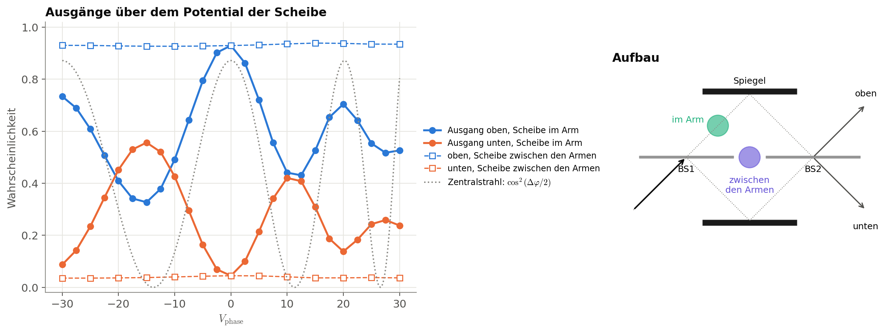

**Scheibe im Arm.** Eine Scheibe (Radius 1) mit Potential $V_{\rm phase}$ ändert dort die lokale Wellenzahl auf $k' = \sqrt{k_0^2 - 2V_{\rm phase}}$, der Weg durch die Scheibe sammelt die Zusatzphase $\Delta\varphi \approx (k' - k_0)\cdot 2r$ (für den Zentralstrahl). Damit wandert die Wahrscheinlichkeit zwischen den Ausgängen hin und her, $P_{\rm oben} \approx \cos^2(\Delta\varphi/2)$: Für den Zentralstrahl ist $\Delta\varphi = \pi$ bei $V_{\rm phase} \approx -14$ und $\approx +11$. Gemessen: Bei $V_{\rm phase} = -15$ kippt das Interferometer, **unten 0,56, oben 0,33**; bei $+10 \dots +12{,}5$ sind beide Ausgänge fast gleich (0,44 gegen 0,42), und bei $+20$ dreht es wieder zurück (oben 0,71). Der Kontrast ist kleiner als beim Zentralstrahl, weil das Paket (Breite $\sigma \approx 1{,}2$ an der Scheibe) breiter ist als die Scheibe: Jeder Teil des Pakets sieht eine andere Sehnenlänge, also eine andere Phase. Für große $|V_{\rm phase}|$ streut die Scheibe außerdem Teile des Pakets weg: Bei $V_{\rm phase} = +30$ kommen nur noch 76 % in einem der beiden Ausgänge an (ohne Scheibe 97 %). Eine abstoßende Scheibe mit $V_{\rm phase}$ nahe $E_{\rm Paket} = 32$ wirkt schon fast wie ein Hindernis.

**Scheibe zwischen den Armen.** Praktisch **keine Wirkung**: Oben bleibt zwischen 0,93 und 0,94. Ein Potential wirkt **lokal**, es steht als $V(x)\psi(x)$ in der Gleichung. Wo $\psi \approx 0$ ist (die Wege laufen 4,2 Einheiten entfernt vorbei), ändert es nichts. Die winzige Änderung kommt von den Ausläufern des Pakets.

### 3c) Aharonov–Bohm-Effekt

**Vektorpotential auf dem Gitter.** Mit $H = \tfrac12(-i\nabla - q\mathbf A)^2 + V$ (hier $q = 1$) wird jede Kante des Gitters mit einer Phase versehen (**Peierls-Substitution**):
$$H_{p,\,p+\mathbf e} = -\frac{1}{2\Delta x^2}\,\exp\Bigl(-iq\!\int_p^{p+\mathbf e}\!\mathbf A\cdot d\mathbf l\Bigr),\qquad \int \mathbf A\cdot d\mathbf l \approx A_e(\text{Kantenmitte})\,\Delta x$$
und die Gegenrichtung komplex konjugiert, damit $H$ hermitesch bleibt. Für konstantes $\mathbf A$ ist das eine reine Eichtransformation, und die Tests prüfen, dass das Spektrum dann exakt gleich bleibt. Ein zweiter Test prüft das Vorzeichen: Ein Paket mit Impuls $k_0$ hat unter konstantem $A_x$ die Energie $(k_0 - qA_x)^2/2 + \dots$, wie es zum kinetischen Impuls $\mathbf p - q\mathbf A$ gehört. Die Spule sitzt bei $(6, 0)$, also zwischen den Armen, mit
$$\mathbf A = \frac{B_0 r}{2}\,\mathbf e_\theta\ (r < r_0),\qquad \mathbf A = \frac{B_0 r_0^2}{2r}\,\mathbf e_\theta\ (r > r_0),\qquad \Phi = \oint\mathbf A\cdot d\mathbf l = \pi B_0 r_0^2.$$

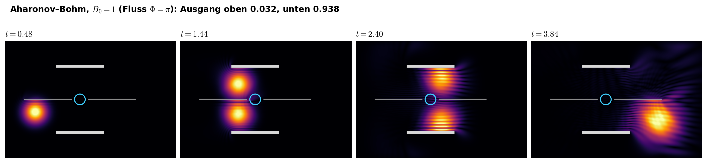

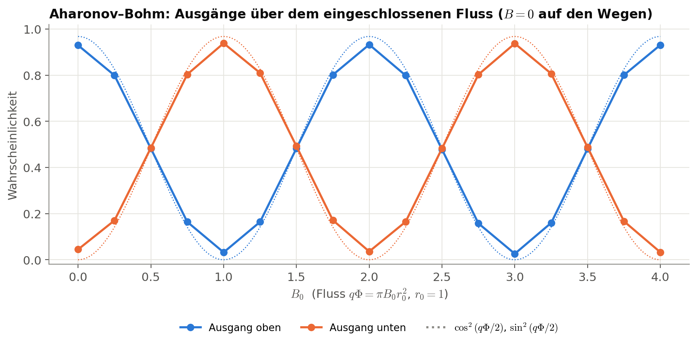

**Ergebnis.** Die Ausgänge folgen fast perfekt $P_{\rm oben} = \cos^2(q\Phi/2)$, $P_{\rm unten} = \sin^2(q\Phi/2)$, mit **Periode $B_0 = 2$**, also Fluss $\Phi = 2\pi/q$. Bei $B_0 = 1$ ($\Phi = \pi$) ist alles vertauscht: **oben 0,032, unten 0,938**; bei $B_0 = 2$ wieder wie ohne Feld (oben 0,933, unten 0,036). Die gepunkteten Kurven sind $\cos^2$ und $\sin^2$, skaliert auf die mittlere Gesamtwahrscheinlichkeit 0,97. Kleine Restabweichung: Das Startpaket ist nicht an $\mathbf A$ angepasst (am Startort ist $|\mathbf A| \le 0{,}17$ gegen $k_0 = 8$), das verschiebt den kinetischen Impuls minimal.

**Warum ändern sich die Ausgänge, obwohl $B = 0$ überall dort ist, wo das Teilchen sein kann?** Die Wellenfunktion auf einem Weg sammelt die Phase $q\int\mathbf A\cdot d\mathbf l$. Die Differenz zwischen den beiden Wegen ist das Integral über die geschlossene Schleife:
$$\Delta\varphi = q\oint\mathbf A\cdot d\mathbf l = q\int\!\!\int \mathbf B\cdot d\mathbf S = q\,\Phi.$$
Diese Phase ist **eichinvariant** und hängt nur vom eingeschlossenen Fluss ab, nicht davon, wo genau die Wege verlaufen. Klassisch spürt ein Teilchen nur die Lorentzkraft, also $\mathbf B$ am eigenen Ort, und hier ist $\mathbf B = 0$. Quantenmechanisch zählt die Phase zwischen Wegen, und die misst den Fluss im Inneren. Darum ist der Unterschied zu 3b grundsätzlich: Das skalare Potential in der Mitte wirkt nur lokal und tut nichts, die Spule in der Mitte vertauscht die Ausgänge vollständig.

**Könnte $\mathbf A$ außerhalb eines beschränkten Gebiets verschwinden?** **Nein.** Für jede Schleife um die Spule gilt nach Stokes $\oint\mathbf A\cdot d\mathbf l = \Phi \ne 0$, in jeder Eichung. Außerhalb eines beschränkten Gebiets gibt es beliebig große Kreise um die Spule; wäre $\mathbf A$ dort null, wäre das Integral null. Durch Eichung kann man $\mathbf A$ nur verschieben, z. B. ganz in einen Schnitt von der Spule nach unendlich legen (dort singulär), aber nie ganz wegnehmen. $\mathbf A$ ist hier physikalisch, auch wenn $\mathbf B$ verschwindet.
